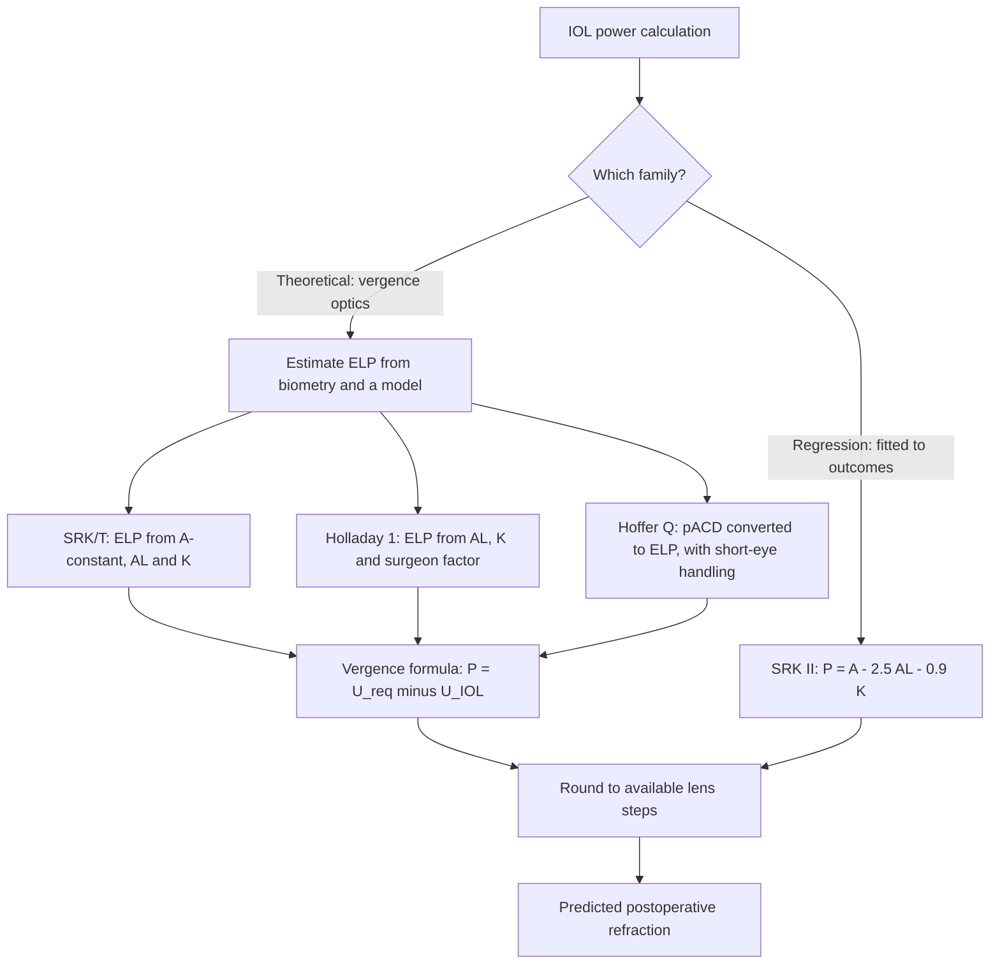
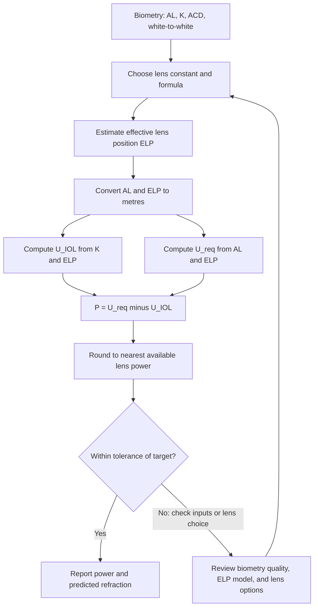
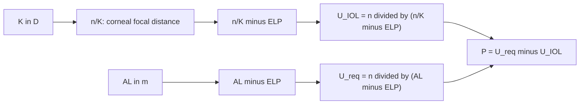
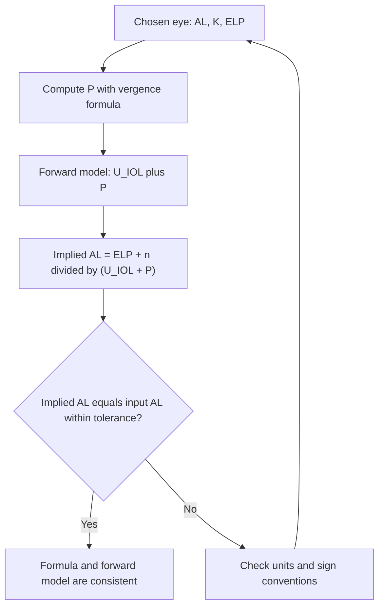
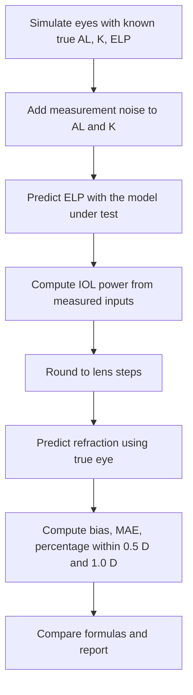

# IOL Power Calculation: Vergence Formulas (SRK/T, Holladay 1, Hoffer Q)

## Important scope note

This project explains the structure and mathematics of intraocular lens (IOL) power calculation and implements a teaching version of the vergence method. It is not a clinical calculator. Clinical IOL calculation software must be validated against the published formulas, their exact constants, and the regulatory requirements that apply to your product. Where this document shows constants, they are either derived here or labeled as illustrative. Use the primary sources in the references, and treat any published constant as something to confirm before use.

## Overview

Before cataract surgery, the surgeon must choose the power of the IOL that will bring the eye close to a target refraction, usually emmetropia. The calculation takes three biometric measurements and a lens constant:

- **Axial length (AL):** the distance from the cornea to the retina.
- **Corneal power (K):** the refractive power of the cornea, usually from keratometry or topography.
- **Anterior chamber depth (ACD) or effective lens position (ELP):** where the IOL will sit.
- **Lens constant:** a manufacturer- and surgeon-specific value that links the lens to its effective position.

Two families of formulas are common:

- **Theoretical (vergence) formulas**, such as SRK/T, Holladay 1, and Hoffer Q. They use optics: the cornea, the IOL, and the retina are modeled with vergence equations, and the main unknown is the effective lens position.
- **Regression formulas**, such as SRK II. They are fitted to clinical outcomes and do not model the optics explicitly.

This project focuses on the vergence method because it makes the physics explicit, then compares it with a regression formula on the same simulated eyes.

In this project we will:

- Derive the thin-lens vergence formula for IOL power in an emmetropic target.
- Explain how the effective lens position enters the calculation and how SRK/T, Holladay 1, and Hoffer Q differ in estimating it.
- Implement the vergence formula, a forward model, and SRK II.
- Verify the calculation by round-trip checks.
- Simulate a validation cohort with known true parameters and compare formulas.
- Analyze error sensitivity to axial length, corneal power, and ELP.

---

## 1. Theory

### 1.1 Units and conventions

Lengths are in metres inside the optical equations and in millimetres in clinical inputs. Vergence $U$ is in dioptres (D), with $U = n/d$ for a wavefront converging to a point at distance $d$ in a medium of refractive index $n$. Converging light has positive vergence in this convention.

The aqueous and vitreous are both approximated by $n_a = 1.336$.

### 1.2 Corneal vergence at the IOL plane

Light from a distant object (vergence 0) is refracted by the cornea with power $K$ (D). The corneal focus lies at $n_a/K$ behind the cornea. At the IOL plane, which lies a distance ELP behind the cornea, the vergence is

$$
U_{\text{IOL}} = \frac{n_a}{\dfrac{n_a}{K} - \text{ELP}}
$$

Because the light is converging, the distance to the focus shrinks as it propagates. The formula gives the vergence that reaches the IOL plane.

### 1.3 Required vergence at the retina

For the eye to be emmetropic, light must focus on the retina, a distance $\text{AL} - \text{ELP}$ behind the IOL plane. The vergence required at the IOL plane, expressed in the same way, is

$$
U_{\text{req}} = \frac{n_a}{\text{AL} - \text{ELP}}
$$

### 1.4 The vergence formula

A thin IOL of power $P$ adds its power to the incoming vergence. Requiring that the retina be in focus gives

$$
\boxed{\;P = \frac{n_a}{\text{AL} - \text{ELP}} - \frac{n_a}{\dfrac{n_a}{K} - \text{ELP}}\;}
$$

with AL and ELP in metres, $K$ in D, and $n_a = 1.336$. This is the core of the theoretical formulas. The published variants differ mainly in how they estimate ELP, how they handle long and short eyes, and how they convert from the corneal plane to the spectacle plane. The vergence form also gives an explicit forward relation between a chosen IOL and the refraction it produces, which is used for validation in Section 6.

### 1.5 Forward relation: refraction from a chosen lens

Given a chosen IOL power $P$ and the true eye (AL$_{\text{true}}$, K, ELP$_{\text{true}}$), the retinal vergence is $U_r = U_{\text{IOL}} + P$. The eye would need $U_{\text{needed}} = n_a/(\text{AL}_{\text{true}} - \text{ELP}_{\text{true}})$ to focus on the retina. Defining the refraction as the mismatch in vergence,

$$
R = U_{\text{needed}} - U_r
$$

gives a negative value (myopia) when the retina is too far from the focus for the chosen lens, and a positive value (hyperopia) otherwise. This is a simplified model: a clinical refraction is measured at the spectacle plane, so a vertex conversion would be applied. The simplification is acceptable here because it is used consistently across formulas.

### 1.6 Effective lens position

ELP is the one quantity the vergence formula does not measure directly. It is estimated from measured quantities and a model. Common approaches:

- **Holladay 1** predicts the effective lens position from AL, K, and a surgeon factor (SF), a per-surgeon offset. The prediction is a linear function of AL with a constant term, and the surgeon factor shifts it.
- **Hoffer Q** predicts an anterior chamber depth (pACD) from the lens constant and then converts it into an ELP through a function of AL and K, with a separate treatment for short eyes.
- **SRK/T** derives a theoretical ELP from the lens's A-constant and the eye's AL and K, using the same vergence engine, then selects the power that matches the target.

The precise constants in each model are published in the original papers and in clinical software. They are not reproduced here. This project keeps ELP as an explicit input so that each model's estimate can be compared on the same eyes.

### 1.7 Regression: SRK II

SRK II is a regression formula:

$$
P = A - 2.5\,\text{AL} - 0.9\,K
$$

with the A-constant $A$ (in a convention where $A$ is about 118 for common posterior chamber lenses), AL in millimetres, and $K$ in D. The published version includes corrections for long and short eyes, which are omitted here. Regression formulas implicitly encode an effective lens position through the A-constant, so their behavior is not directly comparable to vergence formulas without the same forward model.

### 1.8 Lens power steps and rounding

IOLs are manufactured in steps, commonly 0.5 D. The calculated power is rounded to the nearest available step before the refraction is predicted. Rounding can move the outcome by up to 0.25 D, and it should be included in validation.

---

## 2. Algorithm overview

For a single eye with measured AL, K, and an ELP estimate:

1. Convert AL and ELP to metres.
2. Compute $U_{\text{IOL}}$ from K and ELP.
3. Compute $U_{\text{req}}$ from AL and ELP.
4. Compute $P = U_{\text{req}} - U_{\text{IOL}}$.
5. Round $P$ to the nearest available lens step.
6. Optionally, compute the predicted refraction for an alternative true eye, for validation.

The flowcharts below show the same steps with the decision points that matter in practice.

---

## 3. Flowcharts

### 3.1 Formula families



### 3.2 Calculation pipeline



### 3.3 Vergence computation in detail



### 3.4 Round-trip validation



### 3.5 Cohort validation workflow



---

## 4. Setup

```python
import numpy as np
import matplotlib.pyplot as plt

plt.rcParams["figure.figsize"] = (7, 5)
plt.rcParams["figure.dpi"] = 120

N_AQ = 1.336               # aqueous/vitreous refractive index
LENS_STEP = 0.5            # dioptre increments
RANDOM_SEED = 42
rng = np.random.default_rng(RANDOM_SEED)
```

---

## 5. Vergence formula

```python
def vergence_iol_power(K, AL_mm, ELP_mm, n=N_AQ):
    """Theoretical IOL power for emmetropia (dioptres).

    K: corneal power (D); AL_mm: axial length (mm); ELP_mm: effective lens position (mm).
    """
    K = np.asarray(K, dtype=float)
    AL = np.asarray(AL_mm, dtype=float) / 1000.0
    ELP = np.asarray(ELP_mm, dtype=float) / 1000.0
    U_iol = n / (n / K - ELP)     # vergence at the IOL plane
    U_req = n / (AL - ELP)        # vergence needed at the IOL plane for retinal focus
    return U_req - U_iol


def round_to_step(P, step=LENS_STEP):
    return np.round(np.asarray(P) / step) * step
```

### 5.1 Sanity check

```python
P_example = vergence_iol_power(K=43.5, AL_mm=23.5, ELP_mm=5.0)
print(f"Vergence IOL power (K=43.5, AL=23.5, ELP=5.0): {P_example:.2f} D")
print(f"Rounded to available step: {round_to_step(P_example):.1f} D")

# Monotonicity: longer eyes need weaker lenses
for al in [22.5, 23.5, 24.5]:
    print(f"AL = {al:4.1f} mm -> P = {vergence_iol_power(43.5, al, 5.0):6.2f} D")
```

Expected: the power falls as AL rises, and the example lands near 20 D, which is plausible for a standard eye.

---

## 6. Forward model and round-trip check

The forward relation from Section 1.5 lets us test the formula by inverting it.

```python
def retinal_vergence(P, K, ELP_mm, n=N_AQ):
    """Vergence (D) arriving at the retina for a chosen lens power P."""
    K = np.asarray(K, dtype=float)
    ELP = np.asarray(ELP_mm, dtype=float) / 1000.0
    U_iol = n / (n / K - ELP)
    return U_iol + P


def refraction_from_iol(P, K, AL_true_mm, ELP_true_mm, n=N_AQ):
    """Predicted refraction (D) for a true eye. Negative = myopic, positive = hyperopic."""
    AL = np.asarray(AL_true_mm, dtype=float) / 1000.0
    ELP = np.asarray(ELP_true_mm, dtype=float) / 1000.0
    U_needed = n / (AL - ELP)
    U_r = retinal_vergence(P, K, ELP_true_mm, n)
    return U_needed - U_r


def implied_axial_length(P, K, ELP_mm, n=N_AQ):
    """Axial length (mm) that would be emmetropic with lens power P."""
    ELP = np.asarray(ELP_mm, dtype=float) / 1000.0
    U_r = retinal_vergence(P, K, ELP_mm, n)
    return (ELP + n / U_r) * 1000.0
```

### 6.1 Round-trip test

```python
K0, AL0, ELP0 = 43.5, 23.5, 5.0
P0 = vergence_iol_power(K0, AL0, ELP0)
AL_back = implied_axial_length(P0, K0, ELP0)
R0 = refraction_from_iol(P0, K0, AL0, ELP0)

print(f"Chosen power: {P0:.4f} D")
print(f"Implied AL:   {AL_back:.6f} mm (input {AL0} mm)")
print(f"Predicted refraction when AL and ELP are exact: {R0:.2e} D")
assert abs(AL_back - AL0) < 1e-9
assert abs(R0) < 1e-9
```

Expected: the round trip recovers the input axial length to machine precision, and the predicted refraction is zero when the model inputs are exact. Any error in these checks indicates a unit or sign problem.

---

## 7. SRK II regression

```python
def srk2_power(A, AL_mm, K):
    """SRK II regression (no long- or short-eye corrections)."""
    return A - 2.5 * np.asarray(AL_mm, dtype=float) - 0.9 * np.asarray(K, dtype=float)

# Illustrative A-constant only; use the value supplied by the lens manufacturer
A_ILLUSTRATIVE = 118.5
P_srk = srk2_power(A_ILLUSTRATIVE, 23.5, 43.5)
print(f"SRK II (illustrative A={A_ILLUSTRATIVE}): {P_srk:.2f} D")
print(f"Vergence (ELP=5.0 mm):                  {P_example:.2f} D")
```

The two formulas should give similar powers for an average eye. Differences arise from the implicit ELP in the regression and from the choice of constants, not from the optics alone.

---

## 8. Simulated validation cohort

We simulate eyes with known true parameters. The "truth" includes a true ELP that varies between eyes. The calculation uses measured AL with small noise and a model ELP that differs from the truth in a systematic way, which is a realistic source of error.

```python
N = 300
AL_true = np.clip(rng.normal(23.5, 1.0, N), 20.5, 28.0)     # mm
K_true = rng.normal(43.5, 1.2, N)                           # D
ELP_true = rng.normal(5.0, 0.25, N)                         # mm, varies between eyes

AL_meas = AL_true + rng.normal(0.0, 0.03, N)                # biometry noise, mm
K_meas = K_true + rng.normal(0.0, 0.10, N)                  # keratometry noise, D

ELP_model = np.full(N, 4.9)                                 # model ELP: systematic offset from mean truth
```

Two formulas are tested on the same eyes. The vergence formula uses the model ELP. SRK II uses its A-constant, which is set to match the average eye for a fair comparison.

```python
P_verg = round_to_step(vergence_iol_power(K_meas, AL_meas, ELP_model))
P_srk_c = round_to_step(srk2_power(A_ILLUSTRATIVE, AL_meas, K_meas))

R_verg = refraction_from_iol(P_verg, K_true, AL_true, ELP_true)
R_srk = refraction_from_iol(P_srk_c, K_true, AL_true, ELP_true)

def summarize(R, label):
    mae = np.mean(np.abs(R))
    bias = np.mean(R)
    w05 = np.mean(np.abs(R) <= 0.5) * 100
    w10 = np.mean(np.abs(R) <= 1.0) * 100
    print(f"{label:<18} bias {bias:+.3f} D   MAE {mae:.3f} D   "
          f"within 0.5 D {w05:5.1f}%   within 1.0 D {w10:5.1f}%")
    return bias, mae, w05, w10

print("Validation on simulated cohort (true eye parameters used for truth)")
summ_verg = summarize(R_verg, "Vergence (model ELP)")
summ_srk = summarize(R_srk, "SRK II (illustrative)")
```

Interpretation: the systematic ELP offset appears as a bias in the vergence results, while random variation in the true ELP and biometry noise broadens the error distribution. A useful validation reports both: the mean error (bias) and its spread (MAE, and the percentage within clinical tolerances).

### 8.1 Error distribution

```python
plt.figure()
bins = np.linspace(-2.5, 2.5, 41)
plt.hist(R_verg, bins=bins, alpha=0.6, label="Vergence", edgecolor="k")
plt.hist(R_srk, bins=bins, alpha=0.6, label="SRK II", edgecolor="k")
plt.axvline(0, color="k", lw=0.8)
plt.xlabel("Predicted postoperative refraction error (D)")
plt.ylabel("Number of eyes")
plt.title("Refraction Error Distribution on Simulated Cohort")
plt.legend()
plt.show()
```

### 8.2 Error versus axial length

```python
plt.figure()
plt.scatter(AL_true, R_verg, s=10, alpha=0.6, label="Vergence")
plt.scatter(AL_true, R_srk, s=10, alpha=0.6, label="SRK II")
plt.axhline(0, color="k", lw=0.8)
plt.xlabel("True axial length (mm)")
plt.ylabel("Refraction error (D)")
plt.title("Refraction Error versus Axial Length")
plt.legend()
plt.show()
```

Axial length is the strongest determinant of error in most formulas. Systematic trends with AL in a scatter plot are a warning that the formula or its constants are not matched to the population.

---

## 9. Error sensitivity budget

To understand which input matters most, we perturb each input by a clinically realistic amount and measure the change in calculated power.

```python
def sensitivity(base_K=43.5, base_AL=23.5, base_ELP=5.0):
    P0 = vergence_iol_power(base_K, base_AL, base_ELP)
    dAL = vergence_iol_power(base_K, base_AL + 0.1, base_ELP) - P0
    dK = vergence_iol_power(base_K + 0.25, base_AL, base_ELP) - P0
    dELP = vergence_iol_power(base_K, base_AL, base_ELP + 0.1) - P0
    return P0, dAL, dK, dELP

P0, dAL, dK, dELP = sensitivity()
print(f"Base power: {P0:.2f} D")
print(f"Change for +0.10 mm AL:          {dAL:+.3f} D")
print(f"Change for +0.25 D K:            {dK:+.3f} D")
print(f"Change for +0.10 mm ELP:         {dELP:+.3f} D")
```

Interpretation: axial length usually dominates, which is why precise biometry is essential. Effective lens position errors are also significant, which is why ELP prediction is the central difference among the theoretical formulas.

---

## 10. Optional extensions

### 10.1 Long and short eyes

Regression and vergence formulas both lose accuracy for very long or very short eyes, where the lens-to-retina geometry and the ELP model break down. Published formulas add special handling for these ranges. Any implementation must document the ranges in which it is validated.

### 10.2 Target refraction

Most clinical calculations target a refraction other than zero, and they convert the target from the spectacle plane to the corneal plane using the vertex distance. This project uses an emmetropic target only.

### 10.3 Lens constants and optimization

Lens constants can be optimized from a set of patients with known outcomes by minimizing the bias and the spread of predicted refraction. Optimization must use separate training and test cohorts to avoid overstating accuracy.

### 10.4 Uncertainty propagation

Propagating the measured uncertainties in AL, K, and ELP through the vergence formula (for example, by Monte Carlo sampling as in Section 8) gives a distribution of predicted refraction, which is more informative than a single point estimate.

---

## 11. Summary

In this project we:

- Derived the thin-lens vergence formula for IOL power in an emmetropic target.
- Explained the effective lens position and how the theoretical formulas (SRK/T, Holladay 1, Hoffer Q) estimate it, without reproducing their proprietary or unverified constants.
- Implemented the vergence formula, a forward refraction model, and SRK II.
- Verified the calculation with round-trip and monotonicity checks.
- Simulated a validation cohort with known truth and reported bias, MAE, and tolerance percentages.
- Quantified the sensitivity of the result to axial length, corneal power, and ELP.

## References

- Olsen, T. (2007). Calculation of intraocular lens power: a review. *Acta Ophthalmologica Scandinavica*, 85(5), 472–485.
- Retzlaff, J. A., Sanders, D. R., & Kraff, M. C. (1990). Development of the SRK/T intraocular lens implant power calculation formula. *Journal of Cataract and Refractive Surgery*, 16(3), 333–340.
- Holladay, J. T., Prager, T. C., Chandler, T. Y., Musgrove, K. H., Lewis, J. W., & Ruiz, R. S. (1988). A three-part system for refining intraocular lens power calculations. *Journal of Cataract and Refractive Surgery*, 14(1), 17–24.
- Hoffer, K. J. (1993). The Hoffer Q formula: a comparison of theoretic and regression formulas. *Journal of Cataract and Refractive Surgery*, 19(6), 700–712.

These references were written from memory. Verify the authors, volumes, pages, and the formulas and constants against the originals before any clinical or regulatory use.
