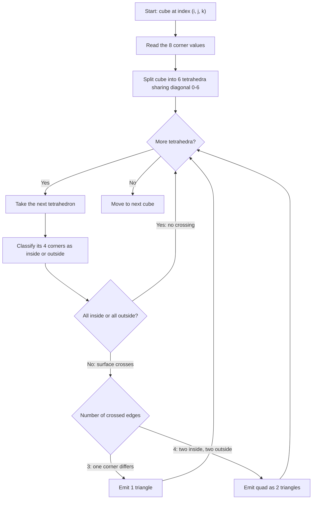
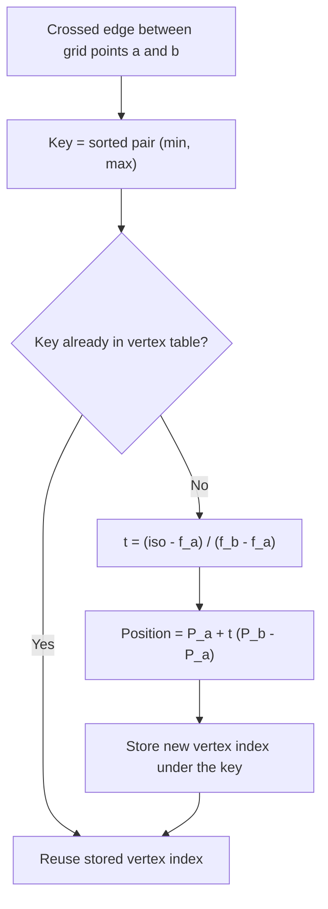
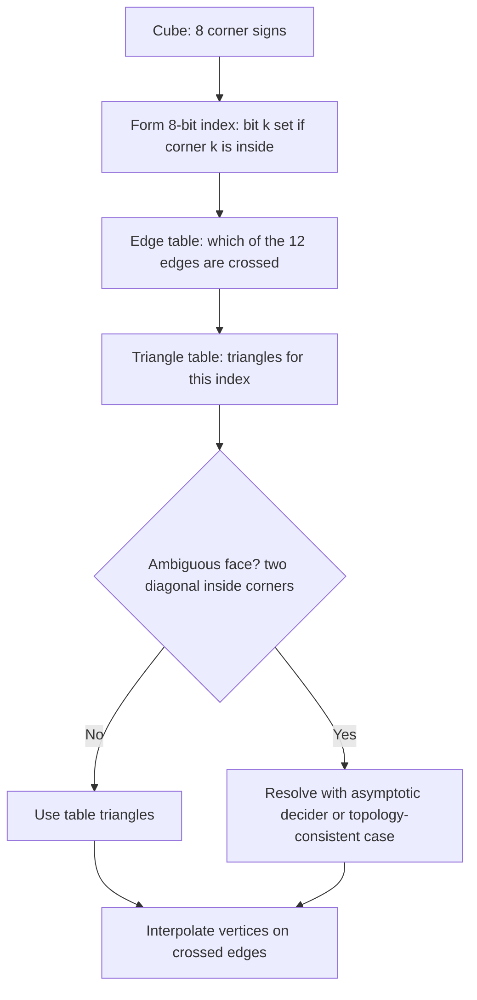
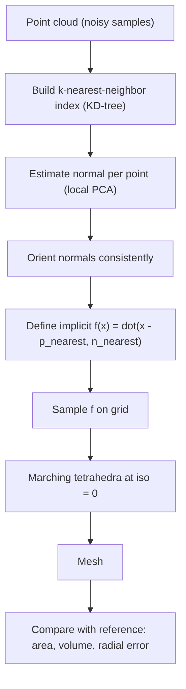

# Marching Cubes and Surface Reconstruction

## Overview

Many 3D problems produce data as a **scalar field**: a value at every point of a volume, such as a signed distance to a shape, a CT density, a level-set function, or an implicit function fitted to a point cloud. Often we need the **surface** where that field crosses a chosen level, called the **isosurface**, as a triangle mesh for rendering, simulation, 3D printing, or measurement.

Marching Cubes (Lorensen & Cline, 1987) extracts that surface from a regular grid. It visits every cell of the grid (a "cube" with eight corners), decides which corners lie inside the surface, and emits the triangles that approximate the surface within that cell. Adjacent cells share edges, so the triangles join into a continuous mesh.

In this project we will:

- Define the isosurface problem and the sampling grid.
- Walk through the cell classification and triangulation logic.
- Implement a correct, watertight extraction using the **marching tetrahedra** variant, which avoids the 256-entry lookup table while keeping the same principles.
- Weld shared vertices, orient faces outward, and compute vertex normals.
- Validate the mesh against analytic area and volume.
- Reconstruct a surface from an oriented point cloud by defining an implicit function and extracting its zero level set.
- Study convergence as the grid is refined.
- Discuss ambiguity, the classic lookup-table algorithm, and production-grade alternatives.

---

## 1. Theory

### 1.1 The isosurface problem

Let $f : \mathbb{R}^3 \to \mathbb{R}$ be a scalar field and $c$ an iso-value. The isosurface is

$$
S = \{\, \mathbf{x} \in \mathbb{R}^3 : f(\mathbf{x}) = c \,\}
$$

We take $c = 0$ for signed distance and implicit surfaces. By convention in this project, a point is **inside** when $f < c$ and **outside** when $f \ge c$.

### 1.2 Sampling

We evaluate $f$ on a regular grid of $n_x \times n_y \times n_z$ points with spacing $h$:

$$
\mathbf{p}_{ijk} = \mathbf{o} + h\,(i, j, k), \qquad f_{ijk} = f(\mathbf{p}_{ijk})
$$

Each cell is the cube with corners $(i,j,k)$ through $(i+1, j+1, k+1)$. A cell is crossed by the surface exactly when its corners are not all on the same side of $c$.

### 1.3 Edge interpolation

If a grid edge joins corners $a$ and $b$ with $f_a < c \le f_b$ (or the reverse), the surface crosses that edge. Linear interpolation estimates the crossing point:

$$
t = \frac{c - f_a}{f_b - f_a}, \qquad \mathbf{x} = \mathbf{p}_a + t\,(\mathbf{p}_b - \mathbf{p}_a)
$$

Because $t \in [0, 1]$ for a crossed edge, the new vertex always lies on the edge.

### 1.4 Classic Marching Cubes

Each cell has $2^8 = 256$ possible inside/outside patterns. The classic algorithm:

1. Build an 8-bit index: bit $k$ is set if corner $k$ is inside.
2. Look up an **edge table** that lists which of the 12 cell edges are crossed.
3. Look up a **triangle table** that lists the triangles for that index, using the crossed edges.
4. Interpolate each crossed edge and emit the triangles.

Symmetry reduces the 256 patterns to 15 unique cases (14 after resolving ambiguity, see Section 1.6). The tables are long, so they are typically generated or pasted from references.

### 1.5 Marching tetrahedra

An alternative splits each cube into **six tetrahedra** that share the main diagonal from corner 0 to corner 6. Within a tetrahedron, each of the four corners is inside or outside, giving only $2^4 = 16$ patterns, and these reduce to three simple cases:

| Inside corners | Crossed edges | Output |
|---|---|---|
| 0 or 4 | 0 | nothing |
| 1 or 3 | 3 | one triangle |
| 2 | 4 | a quadrilateral, split into two triangles |

The split is consistent across neighboring cells: every cell uses the same diagonal direction, so faces match on shared cell boundaries. This consistency is what makes the resulting mesh watertight. The cost is more triangles than classic Marching Cubes, but the logic is short and the tables disappear.

### 1.6 Ambiguous cases

Some classic cases have a **face** where two inside corners are diagonal and the other two are diagonal and outside. The surface can then be connected in two different ways, and a poor choice can open a hole or merge two sheets. Common remedies include the **asymptotic decider** (Nielson, 1991, 2003) and table modifications that guarantee topological consistency (Lewiner et al., 2003). Marching tetrahedra avoids this issue because each tetrahedron has no ambiguous configurations.

### 1.7 Normals

For smooth shading, each vertex needs a normal. The gradient $\nabla f$ points in the direction of increasing $f$, which is outward for a signed distance function. Normals are obtained by interpolating $\nabla f$ at each vertex and normalizing it.

---

## 2. Algorithm Overview

The complete pipeline is:

1. Sample the scalar field on a grid.
2. Classify each grid point as inside or outside.
3. Decompose each cell into simplices (here, tetrahedra).
4. For each crossed simplex edge, compute and store the interpolated vertex, keyed so shared edges reuse the same vertex.
5. Emit triangles, orient them outward, and compute normals.
6. Validate the result (area, volume, edge manifoldness).

The flowchart below summarizes the pipeline.

```mermaid
flowchart LR
    A["Scalar field f(x, y, z)"] --> B["Sample on regular grid"]
    B --> C["Classify grid points: inside or outside iso"]
    C --> D["Triangulate each cell"]
    D --> E["Interpolate crossing points on edges"]
    E --> F["Weld shared vertices"]
    F --> G["Orient faces outward"]
    G --> H["Triangle mesh"]
    H --> I["Validate: area, volume, watertight"]
```



---

## 3. Per-cell logic (marching tetrahedra)

The cell loop visits each cube, splits it into six tetrahedra, and processes each tetrahedron independently.



---

## 4. Vertex interpolation and welding

Every crossed edge produces a vertex. Two adjacent tetrahedra often cross the same edge, so vertices must be shared rather than duplicated. We key each vertex by the pair of grid-point indices it lies between, sorted so the key is unique regardless of traversal order. Because two grid points define one segment, this key is exact and avoids the floating-point rounding that coordinate-based welding can suffer from.



---

## 5. Classic lookup-table route

For reference, the classic algorithm follows a different path inside each cell. The flowchart shows where ambiguity is resolved.



---

## 6. Setup

```python
import time
from collections import Counter

import numpy as np
import matplotlib.pyplot as plt
from mpl_toolkits.mplot3d.art3d import Poly3DCollection
from scipy.ndimage import map_coordinates
from scipy.spatial import cKDTree

plt.rcParams["figure.figsize"] = (7, 6)
plt.rcParams["figure.dpi"] = 120

RANDOM_SEED = 42
rng = np.random.default_rng(RANDOM_SEED)
```

---

## 7. Scalar fields and sampling

```python
def sample_grid(field, lo, hi, n):
    """Evaluate field on an n x n x n grid over [lo, hi]^3."""
    axis = np.linspace(lo, hi, n)
    h = axis[1] - axis[0]
    X, Y, Z = np.meshgrid(axis, axis, axis, indexing="ij")
    P = np.stack([X, Y, Z], axis=-1)
    values = field(P)
    origin = np.array([lo, lo, lo], dtype=float)
    return values, origin, h


def sphere_sdf(radius):
    """Signed distance to a sphere: negative inside, positive outside."""
    return lambda P: np.linalg.norm(P, axis=-1) - radius
```

---

## 8. Cube geometry and the tetrahedral split

```python
# Corner offsets within a cell, numbered 0..7
CORNERS = np.array([
    [0, 0, 0], [1, 0, 0], [1, 1, 0], [0, 1, 0],
    [0, 0, 1], [1, 0, 1], [1, 1, 1], [0, 1, 1],
])

# Six tetrahedra sharing the main diagonal 0-6 (Kuhn split).
# Using the same diagonal in every cell keeps neighboring cells consistent.
TETS = [
    (0, 1, 2, 6), (0, 2, 3, 6), (0, 3, 7, 6),
    (0, 7, 4, 6), (0, 4, 5, 6), (0, 5, 1, 6),
]

# For a 2-vs-2 tetrahedron the four crossed edges form a cycle in this order
QUAD_ORDER = (0, 1, 3, 2)
```

---

## 9. Marching tetrahedra extraction

```python
def marching_tetrahedra(values, origin, h, iso=0.0):
    """Extract a welded triangle mesh from a scalar grid.

    Returns vertices V (N, 3) and faces F (M, 3). Faces are not yet oriented.
    """
    nx, ny, nz = values.shape
    inside = values < iso
    vertex_table = {}      # (sorted grid index pair) -> vertex index
    verts, faces = [], []

    def vertex_on(a, b):
        key = (a, b) if a < b else (b, a)
        if key not in vertex_table:
            va, vb = values[key[0]], values[key[1]]
            t = (iso - va) / (vb - va)
            pa = origin + h * np.array(key[0], dtype=float)
            pb = origin + h * np.array(key[1], dtype=float)
            vertex_table[key] = len(verts)
            verts.append(pa + t * (pb - pa))
        return vertex_table[key]

    for i in range(nx - 1):
        for j in range(ny - 1):
            for k in range(nz - 1):
                corner_ids = [(i + di, j + dj, k + dk) for di, dj, dk in CORNERS]
                for tet in TETS:
                    ids = [corner_ids[c] for c in tet]
                    ins = [bool(inside[p]) for p in ids]
                    if all(ins) or not any(ins):
                        continue                       # no crossing
                    crossed = [(a, b) for a in range(4) for b in range(a + 1, 4)
                               if ins[a] != ins[b]]
                    p = [vertex_on(ids[a], ids[b]) for a, b in crossed]
                    if len(p) == 3:
                        faces.append((p[0], p[1], p[2]))
                    else:                              # 2-vs-2: quadrilateral
                        q = [p[x] for x in QUAD_ORDER]
                        faces.append((q[0], q[1], q[2]))
                        faces.append((q[0], q[2], q[3]))

    V = np.array(verts, dtype=float)
    F = np.array(faces, dtype=int)
    return V, F
```

---

## 10. Orientation and normals

Triangles emitted by the loop are not guaranteed to face outward. We use the gradient of the field to decide, since $\nabla f$ points toward increasing $f$, which is outside.

```python
def field_gradient_at(points, values, origin, h):
    """Trilinear interpolation of the gradient of the sampled field at world points."""
    gx, gy, gz = np.gradient(values, h)
    idx = ((points - origin) / h).T
    return np.stack([map_coordinates(g, idx, order=1) for g in (gx, gy, gz)], axis=1)


def orient_outward(V, F, values, origin, h):
    tri = V[F]
    normals = np.cross(tri[:, 1] - tri[:, 0], tri[:, 2] - tri[:, 0])
    grad = field_gradient_at(tri.mean(axis=1), values, origin, h)
    flip = np.einsum("ij,ij->i", normals, grad) < 0
    F = F.copy()
    F[flip] = F[flip][:, ::-1]
    return F


def vertex_normals(V, values, origin, h):
    g = field_gradient_at(V, values, origin, h)
    return g / np.maximum(np.linalg.norm(g, axis=1, keepdims=True), 1e-12)
```

---

## 11. Full pipeline

```python
def extract_surface(field, lo, hi, n, iso=0.0):
    values, origin, h = sample_grid(field, lo, hi, n)
    V, F = marching_tetrahedra(values, origin, h, iso)
    F = orient_outward(V, F, values, origin, h)
    return V, F, values, origin, h
```

---

## 12. Mesh validation

```python
def mesh_area(V, F):
    t = V[F]
    return 0.5 * np.linalg.norm(np.cross(t[:, 1] - t[:, 0], t[:, 2] - t[:, 0]), axis=1).sum()


def mesh_volume(V, F):
    """Signed volume via the divergence theorem. Positive for outward orientation."""
    t = V[F]
    return np.einsum("ij,ij->i", t[:, 0], np.cross(t[:, 1], t[:, 2])).sum() / 6.0


def is_watertight(F):
    """Every undirected edge must be shared by exactly two faces."""
    edges = Counter()
    for a, b, c in F:
        for e in ((a, b), (b, c), (c, a)):
            edges[tuple(sorted((int(e[0]), int(e[1]))))] += 1
    return all(count == 2 for count in edges.values())
```

---

## 13. Sphere test case

A sphere has known area $4\pi R^2$ and volume $\tfrac{4}{3}\pi R^3$, so it is a good first check.

```python
R = 1.0
t0 = time.perf_counter()
V, F, values, origin, h = extract_surface(sphere_sdf(R), -1.4, 1.4, n=32)
elapsed = time.perf_counter() - t0

area_exact = 4 * np.pi * R**2
vol_exact = 4.0 / 3.0 * np.pi * R**3

print(f"Vertices:    {len(V):,}")
print(f"Triangles:   {len(F):,}")
print(f"Build time:  {elapsed:.2f} s")
print(f"Area:        {mesh_area(V, F):.4f}   (exact {area_exact:.4f})")
print(f"Volume:      {mesh_volume(V, F):.4f}   (exact {vol_exact:.4f})")
print(f"Watertight:  {is_watertight(F)}")
print(f"Mean |radius - R| of vertices: {np.mean(np.abs(np.linalg.norm(V, axis=1) - R)):.5f}")
```

Expected results: the area and volume agree with the exact values to within a fraction of a percent, the mesh is watertight, and vertices lie very close to the true radius.

### 13.1 Visualization

```python
def plot_mesh(V, F, title, max_faces=4000):
    sel = F if len(F) <= max_faces else F[rng.choice(len(F), max_faces, replace=False)]
    fig = plt.figure(figsize=(7, 7))
    ax = fig.add_subplot(projection="3d")
    poly = Poly3DCollection(V[sel], alpha=0.85, edgecolor="k", linewidth=0.05)
    poly.set_facecolor("C0")
    ax.add_collection3d(poly)
    lim = np.abs(V).max()
    ax.set_xlim(-lim, lim)
    ax.set_ylim(-lim, lim)
    ax.set_zlim(-lim, lim)
    ax.set_title(title)
    plt.show()

plot_mesh(V, F, "Marching Tetrahedra: Sphere (SDF, n = 32)")
```

### 13.2 Reference comparison (optional)

If scikit-image is installed, its Marching Cubes implementation (based on Lewiner et al., 2003) provides a reference. Its output uses the grid origin at zero, so we shift it.

```python
try:
    from skimage.measure import marching_cubes

    values_ref, origin_ref, h_ref = sample_grid(sphere_sdf(R), -1.4, 1.4, 32)
    Vs, Fs, _, _ = marching_cubes(values_ref, level=0.0, spacing=(h_ref, h_ref, h_ref))
    Vs = Vs + origin_ref
    print(f"skimage triangles: {len(Fs):,}")
    print(f"skimage area:      {mesh_area(Vs, Fs):.4f}")
    print(f"skimage |volume|:  {abs(mesh_volume(Vs, Fs)):.4f}")
except ImportError:
    print("scikit-image is not installed; skipping the reference comparison.")
```

Note that the two implementations may produce different triangle counts because tetrahedral and cubic decompositions differ. The area and volume should agree closely.

---

## 14. Surface reconstruction from a point cloud

In practice we often have points sampled from a surface, such as from a scanner or a photogrammetry pipeline, and no formula for the surface. Reconstruction proceeds by estimating normals, defining an implicit function that is zero on the surface, and extracting its zero level set with Marching Cubes.



### 14.1 Synthetic noisy samples

```python
def sample_sphere_points(n_points, R=1.0, noise=0.01):
    u = rng.normal(size=(n_points, 3))
    u /= np.linalg.norm(u, axis=1, keepdims=True)
    pts = R * u + rng.normal(0.0, noise, size=(n_points, 3))
    return pts

points = sample_sphere_points(3000, R=1.0, noise=0.01)
print(f"Point cloud: {points.shape[0]} points, radius range "
      f"[{np.linalg.norm(points, axis=1).min():.3f}, {np.linalg.norm(points, axis=1).max():.3f}]")
```

### 14.2 Normal estimation (PCA)

For each point, the normal is the direction of least variance among its nearest neighbors. This is the eigenvector of the local covariance matrix with the smallest eigenvalue, obtained here from the singular value decomposition.

```python
def estimate_normals(points, k=16):
    tree = cKDTree(points)
    _, idx = tree.query(points, k=k)
    normals = np.empty_like(points)
    for i, nb in enumerate(idx):
        local = points[nb] - points[nb].mean(axis=0)
        _, _, vt = np.linalg.svd(local, full_matrices=False)
        normals[i] = vt[-1]
    return normals

normals = estimate_normals(points, k=16)

# PCA gives normals up to sign. Real pipelines propagate a consistent orientation
# (for example along a minimum spanning tree). For this sphere, outward means dot(n, p) > 0.
flip = np.einsum("ij,ij->i", normals, points) < 0
normals[flip] *= -1

cos_err = np.einsum("ij,ij->i", normals, points / np.linalg.norm(points, axis=1, keepdims=True))
print(f"Mean cosine between estimated and true normal: {cos_err.mean():.4f}")
```

### 14.3 Implicit function from oriented points

Each query point is projected onto the tangent plane of its nearest sample. The signed distance along that normal is the implicit value. This is a simple, local implicit function. Production systems often solve a global one, such as Poisson reconstruction (Kazhdan et al., 2006).

```python
def oriented_point_field(points, normals):
    tree = cKDTree(points)
    def field(P):
        flat = P.reshape(-1, 3)
        _, idx = tree.query(flat)
        f = np.einsum("ij,ij->i", flat - points[idx], normals[idx])
        return f.reshape(P.shape[:-1])
    return field

field_pc = oriented_point_field(points, normals)
V_rec, F_rec, values_rec, origin_rec, h_rec = extract_surface(
    field_pc, -1.3, 1.3, n=32, iso=0.0
)
```

### 14.4 Reconstruction quality

```python
print(f"Reconstructed triangles: {len(F_rec):,}")
print(f"Area:   {mesh_area(V_rec, F_rec):.4f}   (exact {area_exact:.4f})")
print(f"Volume: {mesh_volume(V_rec, F_rec):.4f}   (exact {vol_exact:.4f})")
print(f"Watertight: {is_watertight(F_rec)}")
print(f"Mean radial error: {np.mean(np.abs(np.linalg.norm(V_rec, axis=1) - R)):.5f}")

plot_mesh(V_rec, F_rec, "Reconstructed Surface from Oriented Point Cloud")
```

Expected behavior: the reconstruction is close to the sphere. Because the normals are noisy and the implicit function is local, the mesh may show small bumps or holes where the sampling is sparse. Watertightness is not guaranteed for point-cloud reconstruction, since holes in the sampling can open the surface. Checking this metric is part of the validation.

---

## 15. Convergence analysis

For smooth surfaces and linear interpolation, the error in area and volume should decrease roughly as $O(h^2)$, where $h$ is the grid spacing. We test this with a sweep over grid resolutions.

```python
resolutions = [12, 16, 24, 32]
rows = []
for n in resolutions:
    t0 = time.perf_counter()
    V_n, F_n, *_ = extract_surface(sphere_sdf(R), -1.4, 1.4, n=n)
    dt = time.perf_counter() - t0
    h_n = 2.8 / (n - 1)
    rel_area = abs(mesh_area(V_n, F_n) - area_exact) / area_exact
    rel_vol = abs(mesh_volume(V_n, F_n) - vol_exact) / vol_exact
    rows.append((n, h_n, len(F_n), rel_area, rel_vol, dt))

print(f"{'n':>4} {'h':>8} {'triangles':>10} {'rel area err':>13} {'rel vol err':>12} {'time (s)':>9}")
for n, h_n, nt, ra, rv, dt in rows:
    print(f"{n:>4} {h_n:>8.4f} {nt:>10,} {ra:>13.2e} {rv:>12.2e} {dt:>9.2f}")

hs = np.array([r[1] for r in rows])
area_err = np.array([r[3] for r in rows])
vol_err = np.array([r[4] for r in rows])

plt.figure()
plt.loglog(hs, area_err, "o-", label="relative area error")
plt.loglog(hs, vol_err, "s-", label="relative volume error")
plt.loglog(hs, hs**2 * area_err[0] / hs[0]**2, "--", color="gray", label="O(h^2) reference")
plt.xlabel("Grid spacing h")
plt.ylabel("Relative error")
plt.title("Convergence of Marching Tetrahedra on a Sphere")
plt.legend()
plt.show()
```

The slope on the log-log plot estimates the convergence order. Triangle count grows roughly as $1/h^2$, so memory and runtime scale quickly with resolution. This is why adaptive methods and octrees are used for large volumes.

---

## 16. Discussion: classic Marching Cubes vs. marching tetrahedra

| Aspect | Classic Marching Cubes | Marching tetrahedra (this project) |
|---|---|---|
| Cell patterns | 256 indices, 15 unique cases | 16 patterns per tetrahedron, 3 unique cases |
| Lookup tables | Edge and triangle tables required | None |
| Ambiguity | Needs resolution (asymptotic decider or topology fix) | None |
| Triangle count | Fewer, adapted per cell | More, since each cell splits into 6 tetrahedra |
| Implementation effort | Tables are long and error-prone | Short and readable |
| Watertightness | Guaranteed with a correct table | Guaranteed by consistent diagonal split |

Production implementations (for example in scikit-image, VTK, and Open3D) use the classic cube approach with corrected tables, often vectorized or written in C/C++ for speed.

---

## 17. Optional extensions

### 17.1 Performance

The Python loops in Section 9 are clear but slow for large grids. Vectorizing the classification step with NumPy (computing the inside masks for all tetrahedra at once) and then processing only the crossed tetrahedra is an effective first speed-up. Numba or a compiled backend is the next step.

### 17.2 Adaptive resolution

Octrees or sparse grids refine only near the surface. This reduces the number of cells to visit from $O(n^3)$ to roughly $O(n^2)$ for a surface-dominated volume.

### 17.3 Dual contouring and feature preservation

Dual contouring (Ju et al., 2002) places one vertex per cell and uses normals to preserve sharp features such as edges and corners, which plain Marching Cubes smooths away.

### 17.4 Mesh post-processing

Common follow-up steps include Laplacian or Taubin smoothing, decimation (quadric edge collapse), and remeshing for uniform triangle quality. These are typically applied after extraction.

### 17.5 Real volumetric data

For CT or MRI volumes, choose the iso-value by inspecting a histogram, apply a light Gaussian filter to reduce noise, and check that the surface is closed at the volume boundary. Anisotropic voxel spacing is handled by passing a non-uniform spacing to the extraction routine.

---

## 18. Summary

In this project we:

- Defined the isosurface problem and the grid sampling model.
- Described classic Marching Cubes and its 256-case lookup, and the cell logic of marching tetrahedra.
- Implemented a watertight extraction with shared, welded vertices and outward orientation.
- Validated the mesh against exact sphere area and volume, and checked edge manifoldness.
- Reconstructed a surface from an oriented point cloud by defining a local implicit function.
- Measured convergence with grid refinement.
- Outlined extensions for performance, adaptive grids, sharp features, and real data.

## References

- Lorensen, W. E., & Cline, H. E. (1987). Marching cubes: A high resolution 3D surface construction algorithm. *ACM SIGGRAPH Computer Graphics*, 21(4), 163–169.
- Nielson, G. M. (2003). On marching cubes. *IEEE Transactions on Visualization and Computer Graphics*, 9(3), 283–297.
- Lewiner, T., Lopes, H., Vieira, A. W., & Tavares, G. (2003). Efficient implementation of marching cubes' cases with topological guarantees. *Journal of Graphics Tools*, 8(2), 1–15.
- Kazhdan, M., Bolitho, M., & Hoppe, H. (2006). Poisson surface reconstruction. *Proceedings of the Fourth Eurographics Symposium on Geometry Processing*.
- Ju, T., Losasso, F., Schaefer, S., & Warren, J. (2002). Dual contouring of hermite data. *ACM Transactions on Graphics*, 21(3), 339–346.

Citations were written from memory. Please verify them before publishing.
