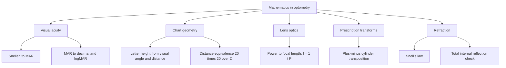
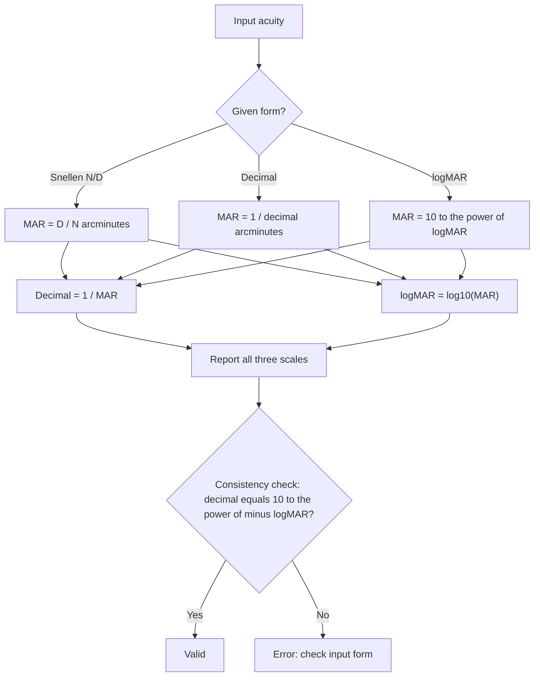
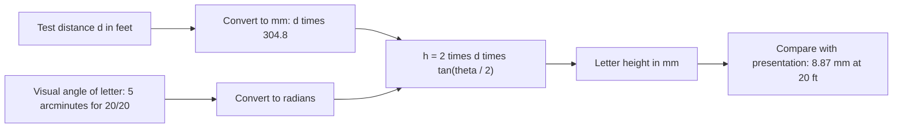
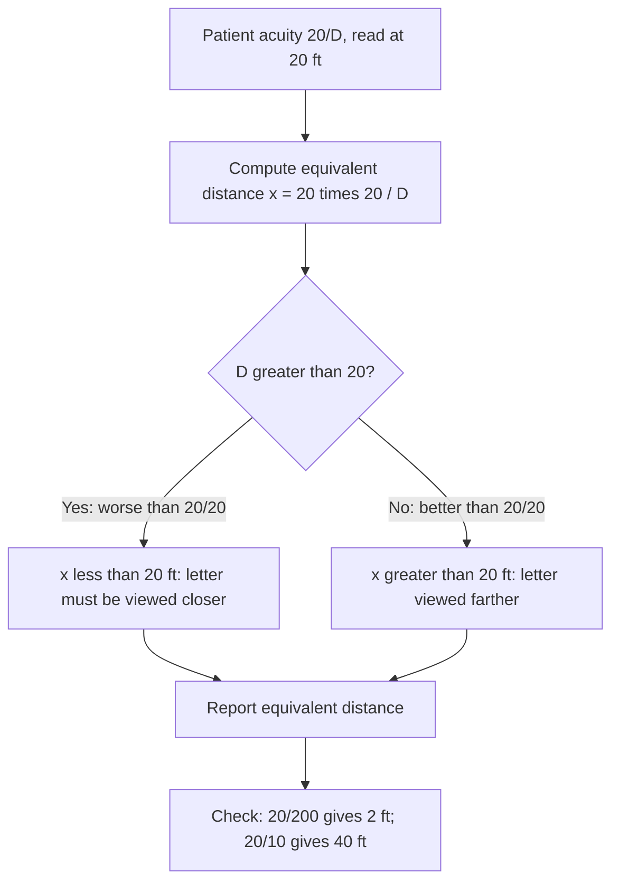
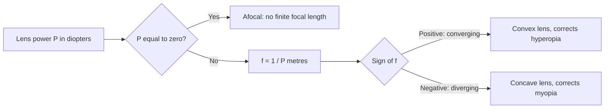
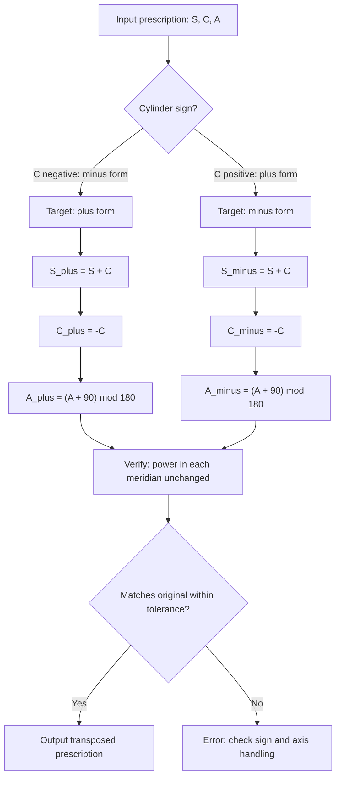
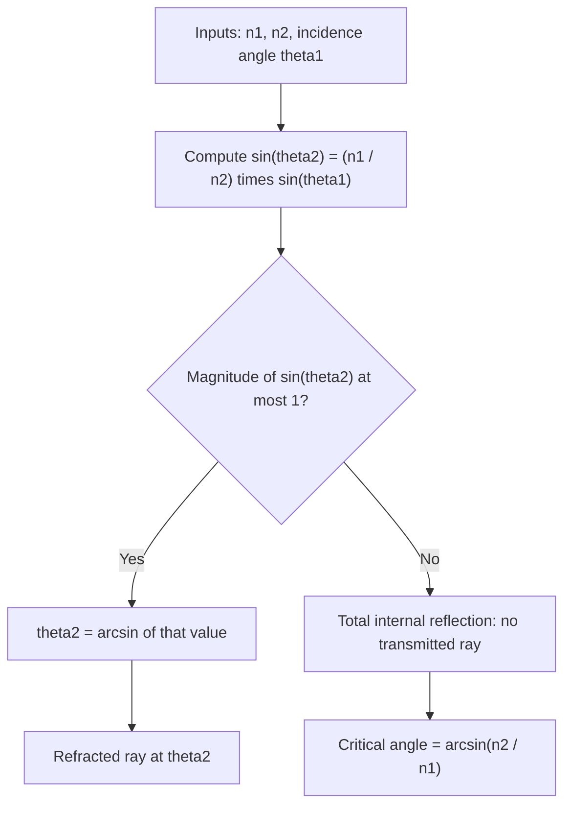
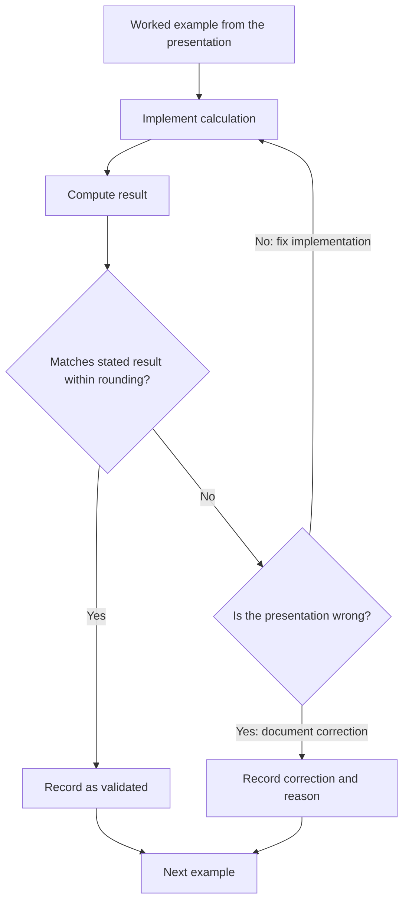

# Mathematics in Optometry

## Source and scope

This project is based on the Prezi presentation *Mathematics in Optometry* by Kahselpaw Nay (last updated June 2, 2016): https://prezi.com/6quitedcn-1o/mathematics-in-optometry/

The presentation is a student work. Its worked examples are useful and mostly correct, but it contains a few errors and unverified historical claims, and it does not define some of the quantities it mentions. This project reproduces its examples, corrects the errors, and expands each topic into an algorithm that can be implemented and tested.

The topics are:

1. Visual acuity: the Snellen fraction, visual angle, and the minimum angle of resolution (MAR).
2. Letter size and distance equivalence on an eye chart.
3. Conversions between Snellen, decimal, and logMAR acuity.
4. Diopters, focal length, and lens power.
5. Sphero-cylinder prescriptions and transposition to minus-cylinder form.
6. Refraction at a boundary: Snell's law.

Clinical use: the formulas here are standard optics and measurement arithmetic. They are teaching and verification tools. Clinical decisions about a patient's vision must be made by a qualified eye-care professional.

## Overview

Optometry relies on a small set of mathematical tools:

- **Angles.** Visual acuity is defined by the smallest angle an eye can resolve. The presentation notes that a degree is 60 arcminutes and an arcminute is 60 arcseconds.
- **Trigonometry.** The size of a letter on a chart follows from its visual angle and the test distance.
- **Ratios and logarithms.** Acuity is written as a fraction (20/40), a decimal (0.5), or a logarithm (logMAR), and these have to be converted.
- **Reciprocals.** Lens power in diopters is the reciprocal of focal length in metres.
- **Algebra on prescriptions.** A spectacle prescription can be written in two equivalent cylinder forms, which requires careful arithmetic.
- **Snell's law.** Light bends at the boundary between media, which is the basis of lens action.

In this project we will:

- Define the visual angle and the minimum angle of resolution.
- Compute letter height from visual angle and distance, and check it against the presentation.
- Derive the distance-equivalence rule behind the presentation's 20/10 and 20/200 examples.
- Implement conversions between Snellen, decimal, and logMAR.
- Implement diopter and focal-length conversions.
- Implement sphero-cylinder transposition and verify it both ways.
- Implement Snell's law, including a check for total internal reflection.
- Validate every calculation against the worked examples in the presentation.

---

## 1. Theory

### 1.1 Angular units

One degree is 60 arcminutes ($'$), and one arcminute is 60 arcseconds ($''$). A full circle is 360 degrees, or 21,600 arcminutes. Visual acuity is an angle, so every acuity calculation converts to arcminutes.

### 1.2 Visual acuity and the minimum angle of resolution

The minimum angle of resolution (MAR) is the smallest angle between two points that an eye can distinguish. The standard optotype (a letter on an eye chart) is designed so that the whole letter subtends 5 arcminutes, and its stroke and gap each subtend 1 arcminute. A person with normal acuity resolves a 1-arcminute detail, so

$$
\text{MAR} = 1' \quad \text{for } 20/20 \text{ (or } 6/6\text{) vision}
$$

### 1.3 Snellen fraction

A Snellen acuity is written $N/D$, where $N$ is the test distance and $D$ is the distance at which a person with normal vision would read the same line. In the imperial form, $N = 20$ feet and the chart is read at 20 feet; in the metric form, $N = 6$ metres. The Snellen fraction corresponds to a MAR of

$$
\text{MAR} = \frac{D}{N} \ \text{arcminutes}
$$

so $20/20$ gives 1 arcminute, $20/40$ gives 2 arcminutes, and $20/10$ gives 0.5 arcminutes. Note that the presentation's "20/10 = better than perfect" matches the formula: a smaller MAR is better.

### 1.4 Letter height from visual angle

Consider a letter of total height $h$ viewed from distance $d$, subtending a total angle $\theta$. The half-height and half-angle form a right triangle, so

$$
\tan\!\left(\frac{\theta}{2}\right) = \frac{h/2}{d} \quad \Longrightarrow \quad h = 2\,d\,\tan\!\left(\frac{\theta}{2}\right)
$$

For the standard 20/20 letter, $\theta = 5'$ and $d = 20$ feet $= 6096$ mm, so $h \approx 8.87$ mm. The presentation's worked steps reach the same result, with one typographical slip noted in Section 7.1.

### 1.5 Distance equivalence

A letter read at $N$ feet with acuity $N/D$ subtends a visual angle proportional to $D/N$. To find the distance $x$ at which a normal eye (20/20) would need to see the same letter size as a 20/200 eye sees at 20 feet, we require the letter to subtend the same angle. Because angular size is inversely proportional to distance for small angles, a 20/200 eye needs the 20/20 letter at one tenth of the distance:

$$
x = 20 \cdot \frac{20}{D} \ \text{feet}
$$

For $D = 200$, $x = 2$ feet (as the presentation says). For $D = 10$ (20/10), $x = 40$ feet. This rule is an equivalence on the distance scale, not on the visual angle; it is valid for small angles.

### 1.6 Acuity scales

Three scales express the same measurement:

| Scale | Definition | 20/20 | 20/200 | 20/10 |
|---|---|---|---|---|
| Snellen | $N/D$ | 20/20 | 20/200 | 20/10 |
| Decimal | $\text{decimal} = 1/\text{MAR}$, equivalently $N/D$ evaluated as a number | 1.0 | 0.1 | 2.0 |
| logMAR | $\log_{10}(\text{MAR})$ | 0.0 | 1.0 | −0.3 |

The decimal and logMAR scales are related by $\text{decimal} = 10^{-\text{logMAR}}$. LogMAR is preferred in research because a line-to-line step is a constant 0.1 logMAR, which makes averaging and statistics meaningful. Legal blindness in the United States is defined in terms of 20/200 or worse in the better eye with correction, which corresponds to logMAR 1.0.

### 1.7 Diopters and focal length

Lens power is measured in diopters, the reciprocal of focal length in metres:

$$
P = \frac{1}{f} \qquad \text{so} \qquad f = \frac{1}{P} \ \text{m}
$$

Positive (converging) lenses have positive power and positive focal length, and negative (diverging) lenses have negative power. The presentation's example is correct: $+1.5$ D gives $f = 0.667$ m, and $-1.5$ D gives $f = -0.667$ m.

### 1.8 Sphero-cylinder prescriptions

A spectacle lens with a cylinder is described by a sphere $S$, a cylinder $C$, and an axis $A$ (0 to 180 degrees). The power in a meridian at angle $\theta$ is

$$
P(\theta) = S + C\,\sin^2(\theta - A)
$$

The same lens can be written in minus-cylinder form ($C \le 0$) or plus-cylinder form ($C \ge 0$). Transposition between them is

$$
S_{\text{plus}} = S_{\text{minus}} + C_{\text{minus}}, \qquad C_{\text{plus}} = -C_{\text{minus}}, \qquad A_{\text{plus}} = A_{\text{minus}} \pm 90^\circ
$$

The axis is reduced modulo 180 degrees. The presentation's example is $-1.25\ \text{DS} / -3.25\ \text{DC} \times 90$, which transposes to $-4.50\ \text{DS} / +3.25\ \text{DC} \times 180$. This matches the rule above: $-1.25 + (-3.25) = -4.50$, the cylinder changes sign, and $90 + 90 = 180$.

The presentation's "minus cylinder steps" (start with the most plus power, find the number that gives the other, use the axis on the same line) describe the same transposition procedure in words.

### 1.9 Snell's law

At an interface between media of refractive indices $n_1$ and $n_2$, a ray at incidence angle $\theta_1$ (measured from the normal) refracts to $\theta_2$:

$$
n_1 \sin\theta_1 = n_2 \sin\theta_2
$$

If $n_1 > n_2$ and $\sin\theta_1 > n_2/n_1$, there is no transmitted ray: total internal reflection. The presentation states the law in words, correctly attributing its discovery to Snell (1621) and describing refraction toward the normal when entering a denser medium.

### 1.10 Prism diopters

A prism of $\Delta$ prism diopters deviates a ray by $\tan\theta = \Delta/100$, where $\theta$ is the deviation angle. This is a standard conversion used in optometry and is included here because it is a small, testable use of trigonometry in the same domain.

---

## 2. Algorithm overview

The calculations group into five modules:

1. **Acuity conversions:** Snellen, decimal, MAR, and logMAR, with consistency checks.
2. **Chart geometry:** letter size from visual angle and distance, and distance equivalence.
3. **Lens optics:** diopter, focal length, and vergence.
4. **Prescription transforms:** sphero-cylinder transposition, with round-trip checks.
5. **Refraction:** Snell's law and total internal reflection.

Each module has a worked example from the presentation, and a validation step that checks the implementation against it.

---

## 3. Flowcharts

### 3.1 Module map



### 3.2 Visual acuity conversion



### 3.3 Letter height from visual angle



### 3.4 Distance equivalence on an eye chart



### 3.5 Diopters and focal length



### 3.6 Sphero-cylinder transposition



### 3.7 Refraction at a boundary



### 3.8 Validation against the presentation



---

## 4. Setup

```python
import math
import numpy as np
import matplotlib.pyplot as plt

plt.rcParams["figure.figsize"] = (7, 5)
plt.rcParams["figure.dpi"] = 120

ARCMIN_PER_DEG = 60.0
FT_TO_MM = 304.8
TEST_DISTANCE_FT = 20.0
LETTER_TOTAL_ARCMIN = 5.0     # standard 20/20 optotype height
```

---

## 5. Visual acuity functions

```python
def mar_from_snellen(numerator, denominator):
    """MAR in arcminutes for a Snellen fraction N/D: MAR = D / N."""
    return denominator / numerator

def mar_from_decimal(decimal_acuity):
    return 1.0 / decimal_acuity

def mar_from_logmar(logmar):
    return 10.0 ** logmar

def decimal_from_mar(mar):
    return 1.0 / mar

def logmar_from_mar(mar):
    return math.log10(mar)

def snellen_report(numerator, denominator):
    """Return Snellen, decimal, MAR and logMAR for a Snellen fraction."""
    mar = mar_from_snellen(numerator, denominator)
    return {
        "snellen": f"{numerator}/{denominator}",
        "mar_arcmin": mar,
        "decimal": decimal_from_mar(mar),
        "logmar": logmar_from_mar(mar),
    }
```

### 5.1 Consistency check and validation

```python
for n, d in [(20, 20), (20, 40), (20, 200), (20, 10)]:
    r = snellen_report(n, d)
    consistent = math.isclose(r["decimal"], 10 ** (-r["logmar"]), rel_tol=1e-12)
    print(f"{r['snellen']:>6}  MAR {r['mar_arcmin']:5.2f}'  decimal {r['decimal']:5.2f}  "
          f"logMAR {r['logmar']:+.2f}  consistent: {consistent}")
    assert consistent

# Validation: legal blindness threshold and normal vision
assert math.isclose(snellen_report(20, 200)["logmar"], 1.0, abs_tol=1e-12)
assert math.isclose(snellen_report(20, 20)["logmar"], 0.0, abs_tol=1e-12)
```

Expected: 20/20 gives logMAR 0.0 and decimal 1.0; 20/200 gives logMAR 1.0 and decimal 0.1; 20/10 gives logMAR −0.3 and decimal 2.0. The decimal and logMAR values are consistent for every case.

---

## 6. Chart geometry

```python
def letter_height_mm(distance_ft, angle_arcmin=LETTER_TOTAL_ARCMIN):
    """Total letter height (mm) for a letter subtending angle_arcmin at distance_ft.

    Uses h = 2 d tan(theta / 2) with theta in radians.
    """
    d_mm = distance_ft * FT_TO_MM
    theta_rad = math.radians(angle_arcmin / ARCMIN_PER_DEG)
    return 2.0 * d_mm * math.tan(theta_rad / 2.0)

def equivalent_distance_ft(denominator, test_distance_ft=TEST_DISTANCE_FT):
    """Distance (ft) at which a 20/20 letter must be viewed to match 20/D at test distance."""
    return test_distance_ft * (test_distance_ft / denominator)
```

### 6.1 Worked example: letter height

```python
h20 = letter_height_mm(20)
print(f"Letter height at 20 ft (5 arcmin total): {h20:.3f} mm")
# Presentation states h = 8.87 mm
assert abs(h20 - 8.87) < 0.01
```

### 6.2 Worked examples: distance equivalence

```python
for D in [10, 20, 40, 200]:
    print(f"20/{D:<4} -> 20/20 letter needed at {equivalent_distance_ft(D):6.2f} ft")

# Presentation: 20/10 -> 40 ft, 20/200 -> 2 ft
assert math.isclose(equivalent_distance_ft(10), 40.0)
assert math.isclose(equivalent_distance_ft(200), 2.0)
```

### 6.3 Letter height versus distance

```python
dist = np.linspace(2, 40, 200)
plt.figure()
plt.plot(dist, [letter_height_mm(x) for x in dist], label="Letter for 20/20 (5 arcmin)")
plt.plot(dist, [letter_height_mm(x, 5.0 * 2) for x in dist], label="Letter for 20/40 (10 arcmin)")
plt.xlabel("Viewing distance (ft)")
plt.ylabel("Letter height (mm)")
plt.title("Letter Height Required for a Given Visual Angle")
plt.legend()
plt.show()
```

---

## 7. Corrections to the presentation

### 7.1 Half-angle notation

The presentation writes "tangent (0.004167 degree)" but the calculation it describes uses $2.5'$ divided by 60, which is $0.04167$ degrees. The value $0.004167$ is a factor of 10 too small. The subsequent numbers (0.0007272 radians and 8.87 mm) correspond to $0.04167$ degrees, so only the printed label is wrong.

### 7.2 Distance-equivalence wording

The presentation's line "20/10 = x/20, 40 ft double the normal vision" is best read as: a patient with 20/10 acuity can read the 20/20 letter at 40 feet. The phrase "double the normal vision" is loose: the factor 2 refers to distance, not to visual performance in general.

### 7.3 Unverified historical claims

Several dates and attributions on the timeline (for example the exact year and form of cylindrical lenses, and the claim that Newton's "axioms" include the law of reflection) need verification against primary sources. The law of reflection predates Newton. Treat the timeline as context, not as a verified history.

### 7.4 Percentage of vision loss

The presentation says optometrists "calculate the percentage of vision loss" but does not give a formula. Several definitions are in use, and the choice depends on the application. Any formula should be stated explicitly, with the reference scale (for example logMAR or the Snellen fraction) and the baseline (for example best-corrected 20/20). This project does not define one.

---

## 8. Lens optics

```python
def focal_length_m(power_D):
    """Focal length in metres from power in dioptres. Returns inf for zero power."""
    if power_D == 0:
        return float("inf")
    return 1.0 / power_D

def power_from_focal_length_m(f_m):
    return 1.0 / f_m
```

### 8.1 Worked examples

```python
for P in [+1.5, -1.5]:
    f = focal_length_m(P)
    print(f"P = {P:+.1f} D -> f = {f:+.3f} m ({f * 100:+.1f} cm)")

# Presentation: +1.5 D -> 0.667 m, -1.5 D -> -0.667 m
assert abs(focal_length_m(1.5) - 0.667) < 0.001
assert abs(focal_length_m(-1.5) + 0.667) < 0.001

# Round trip
assert math.isclose(power_from_focal_length_m(focal_length_m(3.25)), 3.25)
```

---

## 9. Sphero-cylinder transposition

```python
def to_plus_cyl(S, C, A):
    """Minus-cylinder (S, C<=0, A) to plus-cylinder form."""
    if C > 0:
        raise ValueError("Input is already plus-cylinder form.")
    S_p = S + C
    C_p = -C
    A_p = (A + 90.0) % 180.0
    return S_p, C_p, A_p

def to_minus_cyl(S, C, A):
    """Plus-cylinder (S, C>=0, A) to minus-cylinder form."""
    if C < 0:
        raise ValueError("Input is already minus-cylinder form.")
    S_m = S + C
    C_m = -C
    A_m = (A + 90.0) % 180.0
    return S_m, C_m, A_m

def meridional_power(S, C, A, theta_deg):
    """P(theta) = S + C sin^2(theta - A). Used to verify transposition."""
    return S + C * math.sin(math.radians(theta_deg - A)) ** 2
```

### 9.1 Worked example and round trip

```python
S_m, C_m, A_m = -1.25, -3.25, 90.0
S_p, C_p, A_p = to_plus_cyl(S_m, C_m, A_m)
print(f"Minus: {S_m:+.2f} {C_m:+.2f} x {A_m:.0f}")
print(f"Plus:  {S_p:+.2f} {C_p:+.2f} x {A_p:.0f}")

# Presentation: -1.25 - 3.25 x 90 -> -4.50 + 3.25 x 180
assert math.isclose(S_p, -4.50) and math.isclose(C_p, 3.25) and math.isclose(A_p, 180.0)

# Round trip back to minus form
S_back, C_back, A_back = to_minus_cyl(S_p, C_p, A_p)
assert math.isclose(S_back, S_m) and math.isclose(C_back, C_m) and math.isclose(A_back, A_m)
```

### 9.2 Meridional check

Transposition must leave the power in every meridian unchanged.

```python
thetas = np.arange(0, 180, 15)
diff = [abs(meridional_power(S_m, C_m, A_m, t) - meridional_power(S_p, C_p, A_p, t)) for t in thetas]
print(f"Maximum power difference across meridians: {max(diff):.2e} D")
assert max(diff) < 1e-9
```

This check is the same identity used in the vector analysis project, where it was verified for the power vector.

---

## 10. Refraction at a boundary

```python
def snell_refraction(n1, n2, theta1_deg):
    """Return the refraction angle in degrees, or None for total internal reflection."""
    s2 = (n1 / n2) * math.sin(math.radians(theta1_deg))
    if abs(s2) > 1.0:
        return None
    return math.degrees(math.asin(s2))

def critical_angle_deg(n1, n2):
    """Critical angle for light going from n1 into n2 (requires n1 > n2)."""
    if n1 <= n2:
        return None
    return math.degrees(math.asin(n2 / n1))
```

### 10.1 Checks

```python
# Air to water at 30 degrees: expected about 22.1 degrees
t2 = snell_refraction(1.0, 1.333, 30.0)
print(f"Air to water, 30 deg -> {t2:.2f} deg")
assert abs(t2 - 22.1) < 0.1

# Refraction toward the normal when entering a denser medium
assert t2 < 30.0

# Water to air beyond the critical angle: total internal reflection
theta_c = critical_angle_deg(1.333, 1.0)
print(f"Critical angle, water to air: {theta_c:.2f} deg")
print(f"Water to air at 60 deg: {snell_refraction(1.333, 1.0, 60.0)}")
assert snell_refraction(1.333, 1.0, 60.0) is None
```

### 10.2 Refraction curve

```python
theta_in = np.linspace(0, 89, 300)
theta_out = [snell_refraction(1.0, 1.5, t) for t in theta_in]
valid = [(a, b) for a, b in zip(theta_in, theta_out) if b is not None]

plt.figure()
plt.plot([a for a, _ in valid], [b for _, b in valid], label="Air to glass (n = 1.5)")
plt.plot([0, 89], [0, 89], "k--", lw=0.8, label="No bending (reference)")
plt.xlabel("Incidence angle (deg)")
plt.ylabel("Refraction angle (deg)")
plt.title("Snell's Law: Refraction at an Air-Glass Boundary")
plt.legend()
plt.show()
```

Interpretation: entering a denser medium bends the ray toward the normal, so the refraction angle is smaller than the incidence angle.

---

## 11. Prism diopters

```python
def prism_deviation_deg(prism_diopters):
    """Deviation angle (deg) for a prism of given prism diopters: tan(theta) = Delta / 100."""
    return math.degrees(math.atan(prism_diopters / 100.0))

for pd in [1, 5, 10]:
    print(f"{pd:>2} prism diopters -> {prism_deviation_deg(pd):.3f} deg")
```

For small prisms, the deviation in degrees is close to the prism diopters divided by 100 times 57.3, which is a useful check.

---

## 12. Validation summary

```python
checks = {
    "Snellen 20/200 logMAR = 1.0": math.isclose(snellen_report(20, 200)["logmar"], 1.0, abs_tol=1e-12),
    "Snellen 20/20 decimal = 1.0": math.isclose(snellen_report(20, 20)["decimal"], 1.0),
    "Letter height 20 ft ~ 8.87 mm": abs(letter_height_mm(20) - 8.87) < 0.01,
    "20/10 equivalent distance = 40 ft": math.isclose(equivalent_distance_ft(10), 40.0),
    "20/200 equivalent distance = 2 ft": math.isclose(equivalent_distance_ft(200), 2.0),
    "+1.5 D focal length = 0.667 m": abs(focal_length_m(1.5) - 0.667) < 0.001,
    "Transposition -1.25 -3.25 x 90 -> -4.50 +3.25 x 180":
        all(math.isclose(a, b) for a, b in zip(to_plus_cyl(-1.25, -3.25, 90.0), (-4.50, 3.25, 180.0))),
    "Water to air at 60 deg: total internal reflection": snell_refraction(1.333, 1.0, 60.0) is None,
}
for name, ok in checks.items():
    print(f"[{'PASS' if ok else 'FAIL'}] {name}")
assert all(checks.values())
```

Every check should pass. A failure points to the specific example that no longer matches the presentation.

---

## 13. Summary

In this project we:

- Defined the visual angle, the minimum angle of resolution, and the Snellen fraction, and connected them through a single formula.
- Computed letter height from visual angle and distance, and matched the presentation's 8.87 mm.
- Derived the distance-equivalence rule and matched the 20/10 and 20/200 examples.
- Implemented conversions among Snellen, decimal, and logMAR, with a consistency check.
- Implemented diopter and focal-length conversions, matching the ±1.5 D example.
- Implemented sphero-cylinder transposition with round-trip and meridional checks, matching the −1.25 −3.25 × 90 example.
- Implemented Snell's law with total internal reflection, and added prism diopter conversion.
- Corrected a notation error in the presentation, clarified the distance-equivalence wording, and flagged the historical claims and the undefined vision-loss percentage for verification.

## References

- Prezi presentation, *Mathematics in Optometry*, by Kahselpaw Nay, updated June 2, 2016. https://prezi.com/6quitedcn-1o/mathematics-in-optometry/ (the presentation lists its own sources; those were not checked for this project).
- Snellen, H. (1862). *Probebuchstaben zur Bestimmung der Sehschärfe* (Test letters for determining visual acuity). Utrecht. Original Snellen chart reference; verify the exact title and publisher before citing.
- Bailey, I. L., & Lovie, J. E. (1976). New design principles for visual acuity letter charts. *American Journal of Optometry and Physiological Optics*, 53(11), 740–745. Basis of the logMAR chart design.
