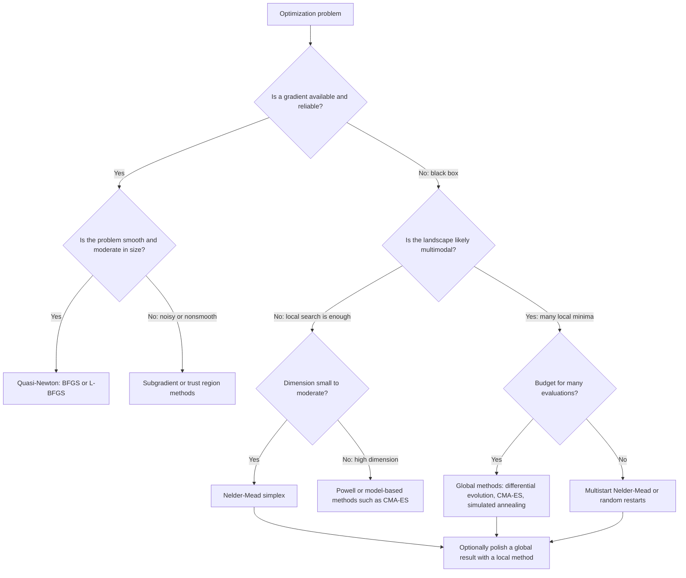
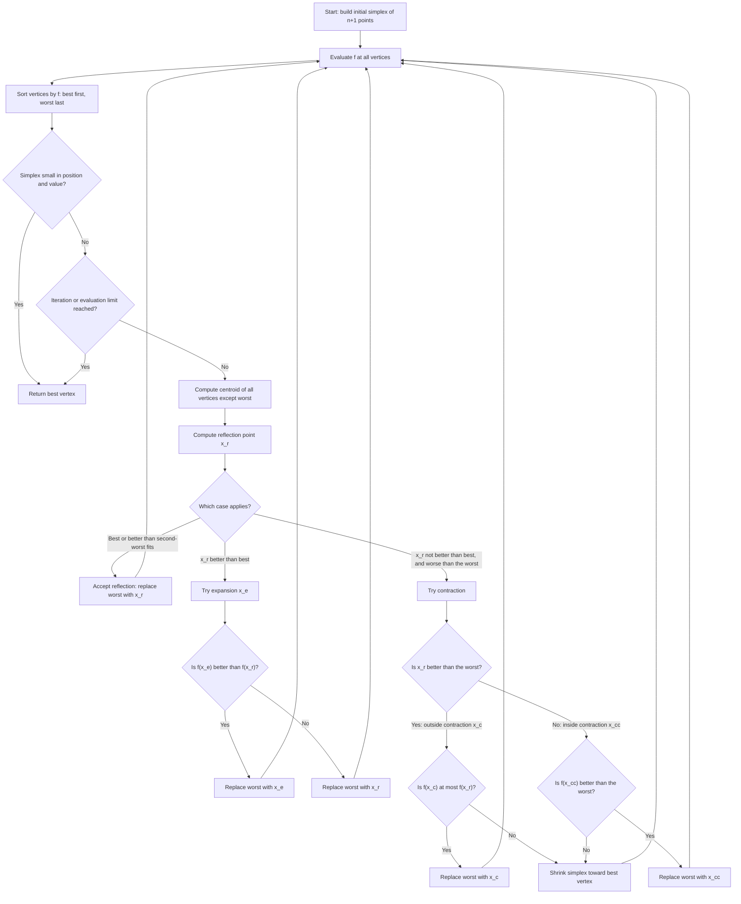
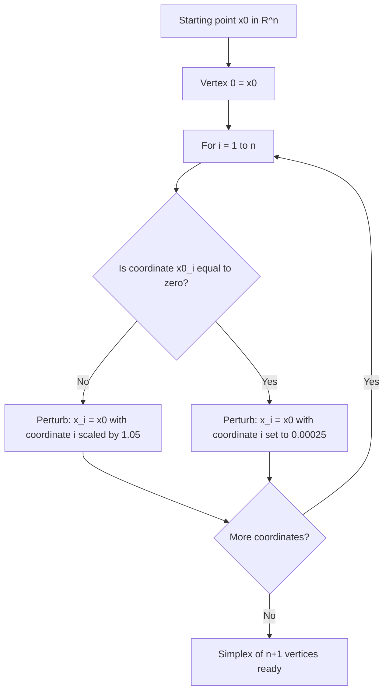
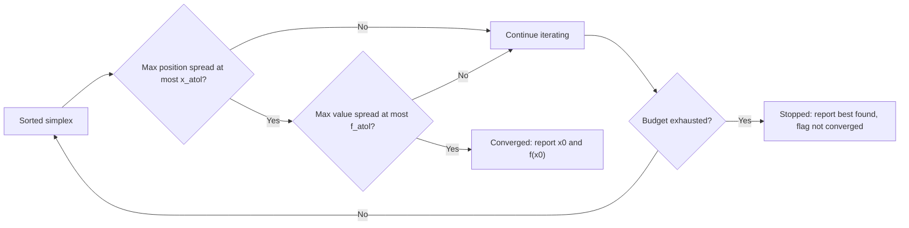
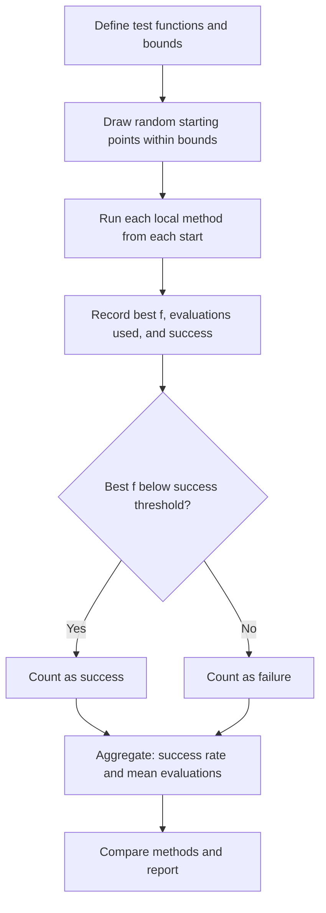

# Nelder-Mead and Optimization Algorithms

## Overview

Optimization means finding the input $\mathbf{x}$ that minimizes (or maximizes) an objective function $f(\mathbf{x})$. Many real problems do not come with a usable gradient: the objective may come from a simulation, a physical experiment, a black-box model, or a noisy measurement. In those cases, **derivative-free** methods are the practical choice.

The Nelder-Mead simplex method (Nelder & Mead, 1965) is the most widely used derivative-free local optimizer. It needs only function values, maintains a simplex of $n+1$ points in $n$ dimensions, and moves that simplex toward lower values by reflecting, expanding, contracting, and shrinking it.

In this project we will:

- Place Nelder-Mead within the broader family of optimization algorithms and explain when each family applies.
- Derive the geometry of the simplex and the four operations.
- Describe stopping criteria, parameter choices, and known failure modes.
- Implement the algorithm from scratch with a full iteration history.
- Validate the implementation against SciPy's reference implementation.
- Benchmark Nelder-Mead against other local methods on standard test functions.
- Study sensitivity to the initial simplex size.
- Outline extensions: adaptive parameters, bounds, and noisy objectives.

---

## 1. Theory

### 1.1 The optimization problem

We seek

$$
\mathbf{x}^* = \arg\min_{\mathbf{x} \in \mathbb{R}^n} f(\mathbf{x})
$$

A **local** minimizer satisfies $f(\mathbf{x}^*) \le f(\mathbf{x})$ for all $\mathbf{x}$ in a neighborhood of $\mathbf{x}^*$. A **global** minimizer satisfies this for all $\mathbf{x}$. Nelder-Mead is a local method: it converges to a local minimum (or occasionally to a non-minimizing point, see Section 1.6), and its result depends on the starting simplex.

### 1.2 The simplex

A simplex in $\mathbb{R}^n$ is the convex hull of $n+1$ affinely independent points $\mathbf{x}_0, \dots, \mathbf{x}_n$. In 2D it is a triangle; in 3D, a tetrahedron. Sort the vertices so that

$$
f(\mathbf{x}_0) \le f(\mathbf{x}_1) \le \cdots \le f(\mathbf{x}_n)
$$

The best vertex is $\mathbf{x}_0$, the worst is $\mathbf{x}_n$, and the centroid of all vertices except the worst is

$$
\bar{\mathbf{x}} = \frac{1}{n}\sum_{i=0}^{n-1} \mathbf{x}_i
$$

Every iteration moves the worst vertex (or all but the best, for shrinking) along a line through the centroid.

### 1.3 The four operations

Let $\alpha > 0$ (reflection), $\gamma > 1$ (expansion), $0 < \rho < 1$ (contraction), and $0 < \sigma < 1$ (shrink). Standard values are $\alpha = 1$, $\gamma = 2$, $\rho = 0.5$, $\sigma = 0.5$.

**Reflection.** Reflect the worst point through the centroid:

$$
\mathbf{x}_r = \bar{\mathbf{x}} + \alpha(\bar{\mathbf{x}} - \mathbf{x}_n)
$$

**Expansion.** If the reflected point is the new best, try going further:

$$
\mathbf{x}_e = \bar{\mathbf{x}} + \gamma(\mathbf{x}_r - \bar{\mathbf{x}})
$$

**Outside contraction.** If the reflected point is better than the worst but not better than the second-worst, contract toward it:

$$
\mathbf{x}_c = \bar{\mathbf{x}} + \rho(\mathbf{x}_r - \bar{\mathbf{x}})
$$

**Inside contraction.** If the reflected point is no better than the worst, contract toward the worst:

$$
\mathbf{x}_{cc} = \bar{\mathbf{x}} + \rho(\mathbf{x}_n - \bar{\mathbf{x}})
$$

**Shrink.** If no contraction helps, shrink the whole simplex toward the best vertex:

$$
\mathbf{x}_i \leftarrow \mathbf{x}_0 + \sigma(\mathbf{x}_i - \mathbf{x}_0), \qquad i = 1, \dots, n
$$

The decision rules, in order:

1. If $f(\mathbf{x}_0) \le f(\mathbf{x}_r) < f(\mathbf{x}_{n-1})$, accept the reflection.
2. If $f(\mathbf{x}_r) < f(\mathbf{x}_0)$, try expansion; keep the better of $\mathbf{x}_e$ and $\mathbf{x}_r$.
3. Otherwise, contract:
   - If $f(\mathbf{x}_r) < f(\mathbf{x}_n)$, outside contraction: accept $\mathbf{x}_c$ if $f(\mathbf{x}_c) \le f(\mathbf{x}_r)$.
   - Otherwise, inside contraction: accept $\mathbf{x}_{cc}$ if $f(\mathbf{x}_{cc}) < f(\mathbf{x}_n)$.
4. If the contraction is not accepted, shrink.

The flowcharts in Section 3 show these rules.

### 1.4 Initial simplex

Given a starting point $\mathbf{x}_0$, the standard construction perturbs one coordinate at a time:

$$
\mathbf{x}_i = \mathbf{x}_0 + s_i \mathbf{e}_i, \qquad s_i = \begin{cases} 0.05\, x_{0,i} & x_{0,i} \neq 0 \\ 0.00025 & x_{0,i} = 0 \end{cases}
$$

The step is therefore relative to the coordinate's magnitude, with a small absolute step when the coordinate is zero. SciPy uses the same rule by default and accepts a custom `initial_simplex`.

### 1.5 Stopping criteria

Two conditions are common. The simplex must be small in position and in function values:

$$
\max_{i} \lVert \mathbf{x}_i - \mathbf{x}_0 \rVert_\infty \le x_{\text{atol}}, \qquad
\max_{i} \lvert f(\mathbf{x}_i) - f(\mathbf{x}_0) \rvert \le f_{\text{atol}}
$$

Also impose a maximum number of iterations or function evaluations.

### 1.6 Properties and failure modes

- **Derivative-free.** Only function values are required.
- **Low overhead per iteration** for small $n$: typically one or two function evaluations, and one for a shrink step of $n$ evaluations.
- **Dimension sensitivity.** Performance degrades as $n$ grows. For $n$ beyond roughly 10, the method usually needs many evaluations.
- **Local behavior.** It finds a local minimum, which depends on the start.
- **Non-stationary limits.** In two dimensions, McKinnon (1998) constructed examples where the simplex converges to a point that is not a local minimum. The method is therefore not guaranteed to find a stationary point.
- **Noise sensitivity.** With noisy objectives, comparisons between vertices become unreliable and the simplex can stagnate or wander. Averaging or restarting helps.

### 1.7 Where Nelder-Mead fits

| Family | Needs | Typical methods | Strength | Weakness |
|---|---|---|---|---|
| Gradient-based local | gradient (and sometimes Hessian) | gradient descent, BFGS, L-BFGS, Newton | fast on smooth problems | requires derivatives |
| Derivative-free local | function values only | Nelder-Mead, Powell, pattern search | robust on black boxes | slow in high dimension |
| Global, stochastic | function values only | random restarts, simulated annealing, genetic algorithms, differential evolution, CMA-ES | can escape local minima | many evaluations |

Nelder-Mead is often used to polish a result from a global search, or as the local step inside a multistart strategy.

---

## 2. Algorithm Overview

The core loop, per iteration:

1. Sort the $n+1$ vertices by function value.
2. Stop if the simplex is small enough in position and value.
3. Compute the centroid of all vertices except the worst.
4. Reflect the worst vertex through the centroid.
5. Expand, contract, or shrink according to the decision rules.
6. Replace the worst vertex if an accepted move produced a better point.

---

## 3. Flowcharts

### 3.1 Taxonomy: choosing an optimization method



### 3.2 Nelder-Mead main loop



### 3.3 Initial simplex construction



### 3.4 Convergence and termination



### 3.5 Benchmark workflow



---

## 4. Setup

```python
import time
import numpy as np
import matplotlib.pyplot as plt
from scipy.optimize import minimize, rosen

plt.rcParams["figure.figsize"] = (7, 5)
plt.rcParams["figure.dpi"] = 120

RANDOM_SEED = 42
rng = np.random.default_rng(RANDOM_SEED)
```

---

## 5. Test functions

Each function has a known global minimum value of zero, which makes success easy to check.

```python
def sphere(x):
    x = np.asarray(x, dtype=float)
    return float(np.sum(x**2))            # minimum 0 at the origin

def himmelblau(x):
    x0, x1 = x
    return float((x0**2 + x1 - 11)**2 + (x0 + x1**2 - 7)**2)  # four minima with value 0

def rastrigin(x):
    x = np.asarray(x, dtype=float)
    return float(10 * x.size + np.sum(x**2 - 10 * np.cos(2 * np.pi * x)))  # many local minima

# rosen (from SciPy) is the Rosenbrock function with minimum 0 at (1, ..., 1)

TEST_PROBLEMS = [
    # name, function, dimension, box for random starts
    ("Rosenbrock 2D", rosen, 2, (-2.0, 2.0)),
    ("Himmelblau 2D", himmelblau, 2, (-5.0, 5.0)),
    ("Rastrigin 2D", rastrigin, 2, (-5.12, 5.12)),
    ("Sphere 5D", sphere, 5, (-3.0, 3.0)),
]
```

---

## 6. From-scratch Nelder-Mead

```python
def nelder_mead(f, x0, step=0.05, max_iter=2000, max_nfev=None,
                xatol=1e-8, fatol=1e-8,
                alpha=1.0, gamma=2.0, rho=0.5, sigma=0.5):
    """Nelder-Mead simplex minimization. Requires n >= 2 for the reflection test."""
    x0 = np.asarray(x0, dtype=float)
    n = x0.size
    if max_nfev is None:
        max_nfev = 200 * n

    # Initial simplex: perturb each coordinate
    simplex = np.empty((n + 1, n))
    simplex[0] = x0
    for i in range(n):
        y = x0.copy()
        y[i] = (1 + step) * y[i] if y[i] != 0 else 0.00025
        simplex[i + 1] = y
    fvals = np.array([f(x) for x in simplex])
    nfev = n + 1

    history = []
    converged = False
    it = 0

    while it < max_iter and nfev < max_nfev:
        order = np.argsort(fvals)
        simplex, fvals = simplex[order], fvals[order]
        history.append(fvals[0])

        if (np.max(np.abs(simplex[1:] - simplex[0])) <= xatol
                and np.max(np.abs(fvals[1:] - fvals[0])) <= fatol):
            converged = True
            break

        it += 1
        xbar = simplex[:-1].mean(axis=0)          # centroid, excluding worst

        # Reflection
        xr = xbar + alpha * (xbar - simplex[-1])
        fr = f(xr)
        nfev += 1

        if fvals[0] <= fr < fvals[-2]:
            simplex[-1], fvals[-1] = xr, fr       # accept reflection

        elif fr < fvals[0]:
            # Expansion
            xe = xbar + gamma * (xr - xbar)
            fe = f(xe)
            nfev += 1
            if fe < fr:
                simplex[-1], fvals[-1] = xe, fe
            else:
                simplex[-1], fvals[-1] = xr, fr

        else:
            # Contraction
            if fr < fvals[-1]:                     # outside contraction
                xc = xbar + rho * (xr - xbar)
                fc = f(xc)
                nfev += 1
                accept = fc <= fr
            else:                                  # inside contraction
                xc = xbar + rho * (simplex[-1] - xbar)
                fc = f(xc)
                nfev += 1
                accept = fc < fvals[-1]

            if accept:
                simplex[-1], fvals[-1] = xc, fc
            else:
                # Shrink toward best vertex
                simplex[1:] = simplex[0] + sigma * (simplex[1:] - simplex[0])
                fvals[1:] = np.array([f(x) for x in simplex[1:]])
                nfev += n

    order = np.argsort(fvals)
    simplex, fvals = simplex[order], fvals[order]
    return {
        "x": simplex[0].copy(),
        "fun": float(fvals[0]),
        "iterations": it,
        "nfev": nfev,
        "converged": converged,
        "history": np.array(history),
    }
```

### 6.1 Sanity checks

```python
res = nelder_mead(rosen, [-1.2, 1.0])
print("Rosenbrock from [-1.2, 1]:", np.round(res["x"], 6), f"f={res['fun']:.2e}",
      f"nfev={res['nfev']}", "converged:", res["converged"])

res = nelder_mead(sphere, [2.0, -3.0, 1.5])
print("Sphere 3D:", np.round(res["x"], 6), f"f={res['fun']:.2e}", f"nfev={res['nfev']}")
```

Expected: Rosenbrock converges near $(1, 1)$ with a small residual, and the sphere converges near the origin.

---

## 7. Validation against SciPy

SciPy's `minimize` with `method="Nelder-Mead"` is a mature reference implementation. Agreement in result is a useful check, though exact evaluation counts can differ because of implementation details.

```python
starts = [rng.uniform(-2, 2, size=2) for _ in range(5)]
print(f"{'start':>22} {'own x':>18} {'scipy x':>18} {'|diff|':>10}")
for x0 in starts:
    mine = nelder_mead(rosen, x0)
    ref = minimize(rosen, x0, method="Nelder-Mead",
                   options={"xatol": 1e-8, "fatol": 1e-8, "maxfev": 5000})
    diff = np.linalg.norm(mine["x"] - ref.x)
    print(f"{np.round(x0, 3)!s:>22} {np.round(mine['x'], 4)!s:>18} "
          f"{np.round(ref.x, 4)!s:>18} {diff:>10.2e}")
```

Expected: both reach the same minimum from most starts. Small differences in the final digits are normal. Different starts can end at different local minima on multimodal functions such as Himmelblau.

---

## 8. Convergence trace

```python
res = nelder_mead(rosen, [-1.2, 1.0], max_nfev=2000)
plt.figure()
plt.semilogy(np.arange(len(res["history"])), res["history"] + 1e-16, "o-", ms=3)
plt.xlabel("Iteration")
plt.ylabel("Best f (log scale)")
plt.title("Nelder-Mead Convergence on Rosenbrock")
plt.show()
```

The best value typically drops quickly through the valley, then slows as the simplex narrows near the minimum. The plateau where the best value stops improving is typical of simplex methods, which can take many small steps along a curved valley.

---

## 9. Benchmark across methods

We compare our Nelder-Mead against SciPy's Nelder-Mead, Powell, and BFGS (BFGS uses numerical gradients here) from random starting points. Success means the best value is below $10^{-6}$.

```python
def run_own_nm(f, x0):
    r = nelder_mead(f, x0, max_nfev=5000)
    return r["x"], r["fun"], r["nfev"]

def run_scipy(method):
    opts = {"maxfev": 5000} if method in ("Nelder-Mead", "Powell") else {"maxiter": 2000}
    def run(f, x0):
        r = minimize(f, x0, method=method, options=opts)
        return r.x, r.fun, r.nfev
    return run

METHODS = {
    "Own Nelder-Mead": run_own_nm,
    "SciPy Nelder-Mead": run_scipy("Nelder-Mead"),
    "SciPy Powell": run_scipy("Powell"),
    "SciPy BFGS": run_scipy("BFGS"),
}

N_STARTS = 30
SUCCESS_TOL = 1e-6
summary = []
t0 = time.perf_counter()

for prob_name, f, dim, (lo, hi) in TEST_PROBLEMS:
    starts = rng.uniform(lo, hi, size=(N_STARTS, dim))
    for m_name, run in METHODS.items():
        fvals, nfevs = [], []
        for x0 in starts:
            _, fb, nf = run(f, x0)
            fvals.append(fb)
            nfevs.append(nf)
        fvals = np.array(fvals)
        success = np.mean(fvals < SUCCESS_TOL)
        summary.append((prob_name, m_name, success, np.mean(nfevs)))

print(f"Benchmark time: {time.perf_counter() - t0:.1f} s")
print(f"{'problem':<16} {'method':<20} {'success':>8} {'mean nfev':>10}")
for prob_name, m_name, s, nf in summary:
    print(f"{prob_name:<16} {m_name:<20} {s:>8.0%} {nf:>10.0f}")
```

Interpretation to expect:
- On Rosenbrock and the sphere, all local methods succeed from most starts, with BFGS typically using far fewer evaluations because it uses gradients.
- On Himmelblau and Rastrigin, local methods succeed only when the start is in the basin of a global minimum. Success rates reflect the landscape, not the algorithm alone. This is the case for multistart or global methods.
- The number of evaluations for Nelder-Mead grows quickly with dimension.

---

## 10. Parameter sensitivity: initial simplex size

The initial step controls the size of the first simplex. Too small and the method may crawl; too large and it may overshoot a narrow valley.

```python
steps = [0.01, 0.05, 0.1, 0.5]
starts_rb = rng.uniform(-2, 2, size=(30, 2))
sens = []
for s in steps:
    successes, nfevs = [], []
    for x0 in starts_rb:
        r = nelder_mead(rosen, x0, step=s, max_nfev=5000)
        successes.append(r["fun"] < SUCCESS_TOL)
        nfevs.append(r["nfev"])
    sens.append((s, np.mean(successes), np.mean(nfevs)))

print(f"{'step':>6} {'success':>8} {'mean nfev':>10}")
for s, succ, nf in sens:
    print(f"{s:>6.2f} {succ:>8.0%} {nf:>10.0f}")
```

Choose the step to match the expected scale of the problem. If the variables differ by orders of magnitude, scale them first.

---

## 11. Noise sensitivity (optional)

```python
def noisy(f, sigma):
    return lambda x: f(x) + rng.normal(0.0, sigma)

for sig in [0.0, 1e-3, 1e-2]:
    r = nelder_mead(noisy(sphere, sig), [1.5, -1.0], max_nfev=2000)
    print(f"noise sigma={sig:g}: x = {np.round(r['x'], 4)}, f_true = {sphere(r['x']):.2e}, "
          f"nfev = {r['nfev']}")
```

With noise, the simplex cannot reliably distinguish vertices that differ by less than the noise level. Results stop improving at roughly that level. Repeated evaluations, averaging, or a larger stopping tolerance are the standard remedies.

---

## 12. Bounds and constraints (outline)

Nelder-Mead has no built-in bounds. Practical options:

1. **Clipping.** Project each candidate point into the box before evaluating $f$. Simple, but can stall at a boundary.
2. **Penalty.** Add a large term for violations, for example $f(\mathbf{x}) + \mu \sum_i \max(0, \lvert x_i - c_i\rvert - h_i)^2$.
3. **Transformation.** Map unbounded variables to a box, for example with $x = a + (b - a)\sin^2(u)$.

Clipping is the simplest to implement and is what many practical wrappers use.

---

## 13. Summary

In this project we:

- Placed Nelder-Mead within the taxonomy of optimization methods, with flowcharts for method choice.
- Derived the simplex geometry, the four operations, the decision rules, and the initial simplex.
- Described stopping criteria and failure modes, including non-stationary limits and noise sensitivity.
- Implemented the algorithm from scratch with an iteration history.
- Validated against SciPy and examined convergence on the Rosenbrock function.
- Benchmarked local methods on four test functions, with success rates and evaluation counts.
- Studied the effect of the initial simplex size and noise.
- Outlined bounds handling.

## References

- Nelder, J. A., & Mead, R. (1965). A simplex method for function minimization. *The Computer Journal*, 7(4), 308–313.
- McKinnon, K. I. M. (1998). Convergence of the Nelder–Mead simplex method to a nonstationary point. *SIAM Journal on Optimization*, 9(1), 148–158.
- Gao, F., & Han, L. (2012). Implementing the Nelder-Mead simplex algorithm with adaptive parameters. *Computational Optimization and Applications*, 51(1), 259–277.
- Kolda, T. G., Lewis, R. M., & Torczon, V. (2003). Optimization by direct search: New perspectives on some classical and modern methods. *SIAM Review*, 45(3), 385–482.

These references were written from memory. Please verify volume, page numbers, and titles against the originals before publishing.
