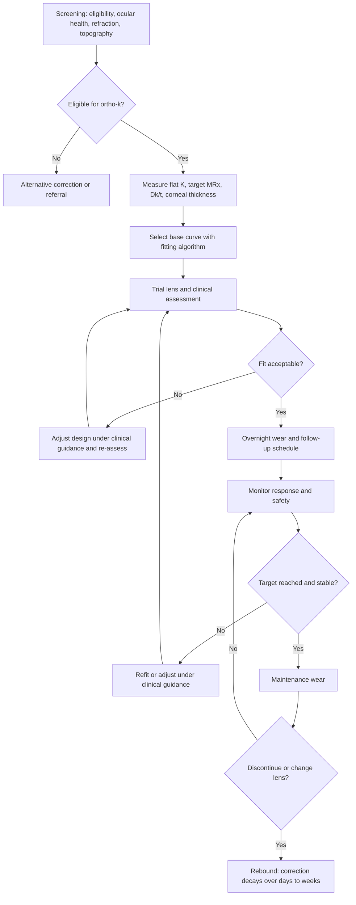
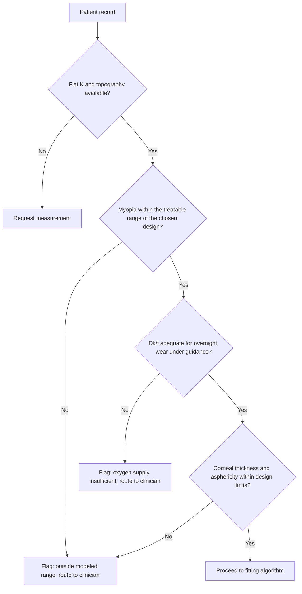
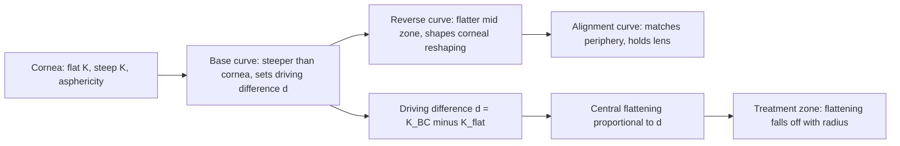
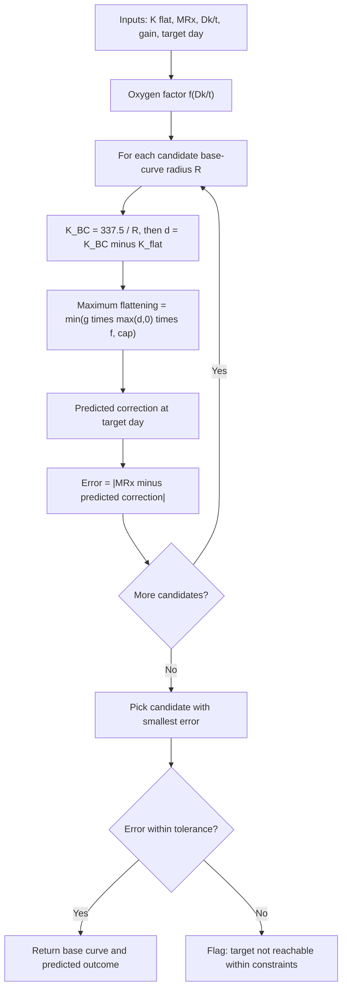
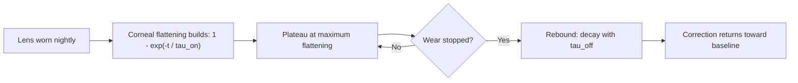
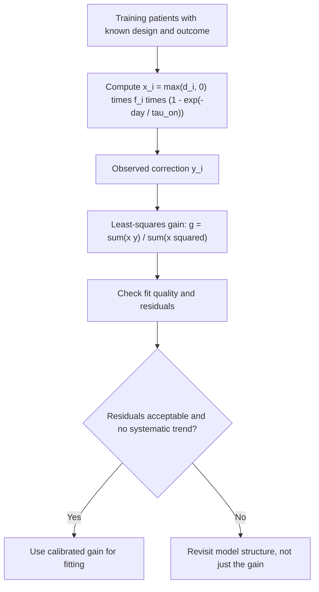
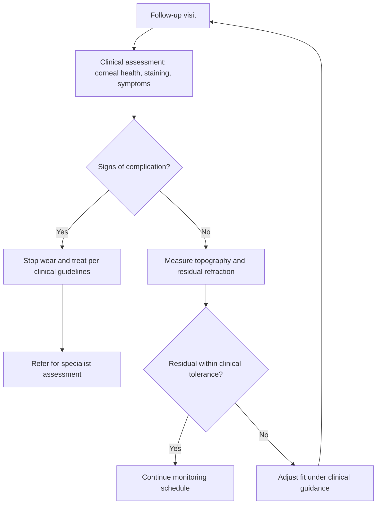

# Orthokeratology: Fitting and Corneal Response Algorithm

## Important scope note

This project is a computational teaching model of orthokeratology (ortho-k). It explains the geometry, the fitting logic, and the outcome modeling in a form that can be implemented and tested.

The response parameters in the code are illustrative. They are chosen to produce plausible curves for demonstration. They are not clinical values, and the model does not predict what any patient will experience. Ortho-k is a medical intervention that depends on clinical examination, the specific lens design and materials, and monitoring for complications. Fitting decisions must follow the lens manufacturer's fitting guide, the relevant clinical guidelines, and the judgment of a qualified eye-care professional. Do not use this model to choose a lens for a patient.

## Overview

Orthokeratology uses rigid gas-permeable lenses worn overnight. The lens has a reverse-geometry design: a central base curve that is steeper than the cornea, surrounded by reverse and alignment curves that hold the lens in place. While the lens is worn, the pressure and the tear layer reshape the central cornea, and the cornea flattens. When the lens is removed, the refractive correction is largely retained during the day, and it gradually reverts when the lens is no longer worn.

The main quantities involved are:

- **Flat keratometry (K flat):** the corneal power in the flattest meridian, from a keratometer or topographer.
- **Base curve (BC):** the central radius of the lens, usually stated in millimetres.
- **Myopia to correct (MRx):** the spherical-equivalent myopia the treatment aims to reduce.
- **Oxygen transmissibility (Dk/t):** the oxygen transmission of the lens material per unit thickness. It affects corneal health and the response to treatment.
- **Corneal response:** the change in central corneal power over days, and the recovery when treatment stops.

In this project we will:

- Derive the keratometric relations used to convert between corneal power and radius.
- Define a simple model of the corneal response to a lens with a given driving difference.
- Describe the treatment zone and the time course, including rebound.
- Implement fitting as a constrained search over base-curve radius, with a safety cap.
- Simulate a cohort with patient-specific response, calibrate the model from outcomes, and evaluate it on held-out patients.
- Discuss limitations, including the tear-lens effect and the spectacle-plane conversion.

---

## 1. Theory

### 1.1 Keratometry and radius

Keratometers assume a fixed index for the cornea to convert measured curvature into power. With the keratometric index $n_k = 1.3375$, the power and radius are related by

$$
K = \frac{337.5}{R}, \qquad R = \frac{337.5}{K}
$$

with $R$ in millimetres and $K$ in dioptres. This is a convention used for measurement, not the true optical power of the cornea, but it is the standard basis for lens fitting.

### 1.2 Reverse-geometry design

A reverse-geometry lens has three central zones, from the centre outward:

1. **Base curve (central zone).** Steeper than the cornea, so the lens presses on the central cornea.
2. **Reverse curve (mid zone).** Flatter than the base curve, so the cornea is allowed to be pushed out and the tear layer forms a corrective profile.
3. **Alignment curve (peripheral zone).** Matches the peripheral cornea to hold the lens in place.

Because the central zone is steeper than the cornea, the difference between the base curve and the cornea drives the reshaping. We call this difference the **driving difference**:

$$
d = K_{\text{BC}} - K_{\text{flat}}, \qquad K_{\text{BC}} = \frac{337.5}{R_{\text{BC}}}
$$

A positive $d$ means the lens is steeper than the cornea. Larger $d$ is expected to produce more central flattening, up to the limits set by the tissue and the design.

### 1.3 Maximum corneal flattening

We model the maximum central flattening as proportional to the driving difference, scaled by a patient-specific gain $g$ and by an oxygen factor $f(\text{Dk/t})$ that reduces the response when oxygen supply is low, and capped by a safety limit $C$:

$$
\Delta K_{\max} = \min\!\big(g \cdot \max(d, 0) \cdot f(\text{Dk/t}),\; C\big)
$$

The oxygen factor is a smooth function that rises from near 0 when oxygen supply is poor to near 1 when it is adequate. The cap $C$ stands in for the limits a fitting protocol imposes. This is a teaching model of a response that clinicians observe empirically and that depends on many factors this model omits.

### 1.4 Time course and rebound

The corneal response builds up over several nights and then approaches a plateau. We use an exponential time course with time constant $\tau_{\text{on}}$:

$$
\Delta K(t) = \Delta K_{\max}\big(1 - e^{-t/\tau_{\text{on}}}\big)
$$

When lens wear stops at time $t_{\text{off}}$, the correction decays with time constant $\tau_{\text{off}}$:

$$
\Delta K(t) = \Delta K(t_{\text{off}})\, e^{-(t - t_{\text{off}})/\tau_{\text{off}}}, \qquad t > t_{\text{off}}
$$

This decay is the **rebound**. Its speed determines how long a correction lasts after discontinuation.

### 1.5 Myopia reduction

We approximate the spectacle-plane change in refraction by the change in central corneal power:

$$
\Delta M(t) = \Delta K(t)
$$

The residual myopia is then $R(t) = \text{MRx} - \Delta M(t)$. A residual of zero is the target. Negative residuals indicate overcorrection. This equivalence ignores the vertex-distance conversion and the tear lens, which are discussed in Section 1.8.

### 1.6 Treatment zone

The reshaping is not uniform. The central flattening is largest at the centre and falls off with distance $r$ from the pupil centre. We model the radial profile as a Gaussian:

$$
\Delta K(r) = \Delta K_{\max}\, e^{-r^2 / (2\sigma^2)}
$$

The treatment zone diameter is the diameter over which the change exceeds a threshold of clinical interest. This profile is illustrative. Real corneas have shapes that depend on the lens design, the cornea's asphericity, and the eccentricity of the pupil.

### 1.7 Fitting as a constrained search

Given a patient's flat keratometry, target myopia, and oxygen factor, the fitter searches for the base-curve radius that makes the predicted correction at a chosen day closest to the target. It rejects solutions that exceed the cap. This turns fitting into a one-dimensional constrained search, the same kind of search used for lens selection in other formula-based fitting.

If no base curve within the search range gives a predicted correction close to the target, the case is outside the modeled treatable range. The output should then be a flag for clinical review, not a forced choice.

### 1.8 Limitations

- **Tear lens.** The fluid layer between the lens and the cornea acts as a lens of its own, and its power depends on the base curve and the lens centre thickness. Real fitting software accounts for it. This model does not.
- **Vertex conversion.** Corneal power and spectacle refraction differ by the vertex distance. The model uses an identity conversion.
- **Patient response.** Real responses vary with age, lens material, wear schedule, corneal thickness, and biological factors. The gain $g$ is a single number here.
- **Asphericity and topography.** Real fitting uses full corneal topography and the eccentricity of the surface. This model uses flat keratometry only.

---

## 2. Algorithm overview

Fitting for one patient:

1. Read flat keratometry, target myopia, and oxygen transmissibility.
2. Compute the oxygen factor.
3. Search over candidate base-curve radii.
4. For each candidate, compute the driving difference, the maximum flattening (with cap), and the predicted correction at the chosen day.
5. Choose the candidate whose predicted correction is closest to the target.
6. Flag the case if the error exceeds a tolerance, or if the required flattening exceeds the cap.
7. Predict the time course, including the rebound after discontinuation.

---

## 3. Flowcharts

### 3.1 Ortho-k workflow overview



### 3.2 Pre-fit eligibility and data checks



### 3.3 Reverse-geometry lens design



### 3.4 Base-curve fitting loop



### 3.5 Corneal response and rebound



### 3.6 Calibration from outcomes



### 3.7 Safety monitoring



---

## 4. Setup

```python
import numpy as np
import matplotlib.pyplot as plt
from scipy.optimize import minimize_scalar

plt.rcParams["figure.figsize"] = (7, 5)
plt.rcParams["figure.dpi"] = 120

RANDOM_SEED = 42
rng = np.random.default_rng(RANDOM_SEED)

KERATO_CONST = 337.5          # mm * D, from keratometric index 1.3375

# Illustrative response parameters (NOT clinical values)
TAU_ON = 2.0                  # days, build-up time constant
TAU_OFF = 1.5                 # days, rebound time constant
CAP_D = 3.0                   # maximum corneal flattening accepted by this model, D
OXY_MID = 40.0                # Dk/t midpoint of the oxygen factor (illustrative units)
OXY_SCALE = 10.0              # steepness of the oxygen factor
TARGET_DAY = 7.0              # day at which the fitting targets the correction
LENS_TOL = 0.25               # D, tolerance for flagging a fit as off target
```

---

## 5. Keratometric and oxygen functions

```python
def radius_from_K(K):
    return KERATO_CONST / np.asarray(K, dtype=float)

def K_from_radius(R):
    return KERATO_CONST / np.asarray(R, dtype=float)

def oxygen_factor(dk_t):
    """Smooth factor in [0, 1]: near 0 for low oxygen supply, near 1 for high."""
    return 1.0 / (1.0 + np.exp(-(np.asarray(dk_t, dtype=float) - OXY_MID) / OXY_SCALE))
```

### 5.1 Checks

```python
R_test = radius_from_K(43.5)
print(f"K = 43.5 D -> R = {R_test:.3f} mm -> K back = {K_from_radius(R_test):.3f} D")
assert abs(K_from_radius(R_test) - 43.5) < 1e-12

for dk in [20, 40, 60, 100, 150]:
    print(f"Dk/t = {dk:3d} -> oxygen factor {oxygen_factor(dk):.3f}")
```

---

## 6. Corneal response model

```python
def driving_difference(R_bc, K_flat):
    """d = K_BC - K_flat. Positive means the lens is steeper than the cornea."""
    return K_from_radius(R_bc) - K_flat

def max_flattening(d, dk_t, gain):
    """Maximum central flattening (D), with oxygen factor and safety cap."""
    raw = gain * np.maximum(d, 0.0) * oxygen_factor(dk_t)
    return np.minimum(raw, CAP_D)

def correction_on_treatment(t_days, dK_max):
    """Build-up while lens is worn continuously."""
    t = np.asarray(t_days, dtype=float)
    return dK_max * (1.0 - np.exp(-t / TAU_ON))

def correction_with_rebound(t_days, dK_max, t_off):
    """Build-up until t_off, then exponential rebound."""
    t = np.asarray(t_days, dtype=float)
    on = dK_max * (1.0 - np.exp(-np.minimum(t, t_off) / TAU_ON))
    dK_off = dK_max * (1.0 - np.exp(-t_off / TAU_ON))
    off = dK_off * np.exp(-np.maximum(t - t_off, 0.0) / TAU_OFF)
    return np.where(t <= t_off, on, off)
```

---

## 7. Fitting algorithm

```python
def fit_base_curve(K_flat, MRx, dk_t, gain, day=TARGET_DAY,
                   R_grid=np.arange(7.00, 9.001, 0.01)):
    """Search base-curve radii for the one whose predicted correction is closest to MRx.

    Returns the chosen radius, predicted correction, error, a flag, and the full search table.
    """
    rows = []
    for R in R_grid:
        d = driving_difference(R, K_flat)
        dK_max = max_flattening(d, dk_t, gain)
        pred = correction_on_treatment(day, dK_max)
        rows.append((R, float(d), float(dK_max), float(pred), abs(MRx - pred)))
    table = np.array(rows)
    i = np.argmin(table[:, 4])
    R_best, d_best, dK_best, pred_best, err_best = table[i]
    flag = err_best > LENS_TOL
    return {
        "R_bc": R_best, "predicted": pred_best, "error": err_best,
        "flag": bool(flag), "table": table,
    }
```

### 7.1 Example fitting

```python
K_flat_ex, MRx_ex, dk_ex, gain_ex = 43.5, 2.5, 100.0, 0.35
fit_ex = fit_base_curve(K_flat_ex, MRx_ex, dk_ex, gain_ex)
print(f"Chosen base curve: {fit_ex['R_bc']:.2f} mm "
      f"(K_BC = {K_from_radius(fit_ex['R_bc']):.2f} D)")
print(f"Predicted correction at day {TARGET_DAY:.0f}: {fit_ex['predicted']:.2f} D "
      f"(target {MRx_ex} D)")
print(f"Flagged: {fit_ex['flag']}")

plt.figure()
plt.plot(fit_ex["table"][:, 0], fit_ex["table"][:, 3], label="Predicted correction at day 7")
plt.axhline(MRx_ex, color="k", ls="--", lw=0.8, label="Target MRx")
plt.axvline(fit_ex["R_bc"], color="C3", ls=":", lw=1, label="Chosen base curve")
plt.xlabel("Base-curve radius (mm)")
plt.ylabel("Predicted correction (D)")
plt.title("Base-Curve Search for One Example Patient")
plt.legend()
plt.show()
```

Interpretation: the predicted correction rises as the base curve gets steeper (smaller radius), until the cap is reached. The search picks the radius where the curve crosses the target. If the target lies above the plateau, the flag is raised.

---

## 8. Simulated cohort, calibration, and evaluation

The simulation has patient-specific gains, which are unknown to the fitter. The fitter learns a single gain from outcomes of earlier fits, then uses it on new patients. This tests whether a calibrated model transfers to patients it has not seen.

```python
N = 400
K_flat = rng.normal(43.5, 1.3, N)
MRx = rng.uniform(1.0, 3.5, N)
dk_t = np.clip(rng.normal(100.0, 25.0, N), 20.0, 160.0)
g_true = np.clip(rng.normal(0.35, 0.08, N), 0.15, 0.6)   # patient-specific response (unknown to fitter)

idx = rng.permutation(N)
tr, te = idx[:200], idx[200:]
```

### 8.1 Training outcomes from a range of lens designs

Historical lenses were chosen by varied design offsets, so the training set spans a range of driving differences. Outcomes are observed at the target day with measurement noise.

```python
offset_design = rng.uniform(0.5, 2.5, N)                     # D, design choice for training lenses
R_train_lens = radius_from_K(K_flat + offset_design)

d_train = driving_difference(R_train_lens, K_flat)
f_train = oxygen_factor(dk_t)
time_factor = 1.0 - np.exp(-TARGET_DAY / TAU_ON)

# Observed correction at target day: true response plus measurement noise
obs = np.minimum(g_true * np.maximum(d_train, 0) * f_train, CAP_D) * time_factor
obs = obs + rng.normal(0.0, 0.15, N)

# Least-squares gain calibrated on training patients only
x_tr = np.maximum(d_train[tr], 0) * f_train[tr] * time_factor
g_hat = np.sum(x_tr * obs[tr]) / np.sum(x_tr ** 2)
print(f"Calibrated gain: {g_hat:.3f}   (true mean gain {g_true.mean():.3f})")

pred_tr = g_hat * x_tr
resid_tr = obs[tr] - pred_tr
print(f"Training residual SD: {resid_tr.std(ddof=1):.3f} D")
```

Note: a true response that varies from patient to patient cannot be captured by one shared gain. The residual spread in the training set measures how much error that simplification introduces.

### 8.2 Fitting on held-out patients

```python
R_model, pred_model, err_model, flag_model = [], [], [], []
R_base = radius_from_K(K_flat[te] + 1.5)                      # fixed baseline design: 1.5 D offset

for i in te:
    f = fit_base_curve(K_flat[i], MRx[i], dk_t[i], g_hat)
    R_model.append(f["R_bc"])
    flag_model.append(f["flag"])

R_model = np.array(R_model)
flag_model = np.array(flag_model)

def achieved_correction(R_bc, idx_local):
    """Outcome at the target day in each test patient's true eye."""
    i = te[idx_local]
    d = driving_difference(R_bc, K_flat[i])
    dK_max = np.minimum(g_true[i] * np.maximum(d, 0) * oxygen_factor(dk_t[i]), CAP_D)
    return correction_on_treatment(TARGET_DAY, dK_max)

ach_model = np.array([achieved_correction(R_model[j], j) for j in range(len(te))]).ravel()
ach_base = np.array([achieved_correction(R_base[j], j) for j in range(len(te))]).ravel()
MRx_te = MRx[te]

res_model = MRx_te - ach_model
res_base = MRx_te - ach_base

def summarize(res, label):
    print(f"{label:<22} bias {np.mean(res):+.3f} D   MAE {np.mean(np.abs(res)):.3f} D   "
          f"within 0.5 D {np.mean(np.abs(res) <= 0.5) * 100:5.1f}%   "
          f"within 1.0 D {np.mean(np.abs(res) <= 1.0) * 100:5.1f}%")

summarize(res_base, "Fixed-offset baseline")
summarize(res_model, "Calibrated fitting")
print(f"Flagged for review: {flag_model.sum()} of {len(te)} patients")
```

Interpretation: a residual is the myopia left uncorrected at the target day (positive) or the overcorrection (negative). The calibrated fitter should reduce the spread relative to a fixed design, but it cannot remove patient-to-patient variation that the single gain does not capture. Flagged patients are the ones the fitter could not bring within tolerance.

### 8.3 Residuals by patient response

```python
plt.figure()
plt.scatter(g_true[te], res_model, s=12, alpha=0.6)
plt.axhline(0, color="k", lw=0.8)
plt.xlabel("True patient response gain")
plt.ylabel("Residual myopia after fitting (D)")
plt.title("Calibrated Fitting Residual versus Patient Response")
plt.show()
```

If residuals trend with the true gain, the single calibrated gain is too simple. A model with a dependence on Dk/t, age, or baseline corneal thickness would be the next step, with the same calibration and held-out evaluation.

---

## 9. Treatment zone

```python
def treatment_profile(dK_max, r_mm, sigma_mm=1.8):
    return dK_max * np.exp(-r_mm ** 2 / (2.0 * sigma_mm ** 2))

r = np.linspace(0, 5.0, 501)
dK_ex = max_flattening(driving_difference(fit_ex["R_bc"], K_flat_ex), dk_ex, gain_ex)
profile = treatment_profile(dK_ex, r)

ZONE_THRESHOLD = 0.25   # D, illustrative threshold for the zone edge
inside = r[profile >= ZONE_THRESHOLD]
zone_diam = 2 * inside.max() if inside.size else 0.0
print(f"Maximum central flattening: {dK_ex:.2f} D")
print(f"Illustrative treatment zone diameter (>= {ZONE_THRESHOLD} D): {zone_diam:.2f} mm")

plt.figure()
plt.plot(r, profile, label="Corneal flattening profile")
plt.axhline(ZONE_THRESHOLD, color="gray", ls="--", lw=0.8, label="Zone threshold")
plt.xlabel("Distance from pupil centre (mm)")
plt.ylabel("Flattening (D)")
plt.title("Illustrative Treatment-Zone Profile")
plt.legend()
plt.show()
```

The zone diameter depends on the threshold and on the profile width, both of which are illustrative here. A clinical treatment zone is measured from topography, not predicted by this model.

---

## 10. Time course and rebound

```python
t = np.linspace(0, 30, 301)
dK_ex = max_flattening(driving_difference(fit_ex["R_bc"], K_flat_ex), dk_ex, gain_ex)
curve_continuous = correction_on_treatment(t, dK_ex)
curve_stop = correction_with_rebound(t, dK_ex, t_off=21.0)

plt.figure()
plt.plot(t, curve_continuous, label="Continuous wear")
plt.plot(t, curve_stop, label="Wear stopped at day 21")
plt.axhline(MRx_ex, color="k", ls="--", lw=0.8, label="Target MRx")
plt.xlabel("Days")
plt.ylabel("Predicted correction (D)")
plt.title("Predicted Time Course and Rebound")
plt.legend()
plt.show()

print(f"Correction at day 21 before stopping: {correction_on_treatment(21.0, dK_ex):.2f} D")
print(f"Correction at day 28 after stopping:  {correction_with_rebound(28.0, dK_ex, 21.0):.2f} D")
```

Interpretation: the curve shows build-up, plateau, and rebound. The rebound timescale is a key input for planning follow-up and is one of the least certain parameters in any model of this kind.

---

## 11. Limitations and extensions

### 11.1 Tear-lens correction

The tear layer contributes its own power, which must be subtracted from the lens-induced change to get the spectacle correction. A fitting model should include a tear-lens term that depends on the base curve, the reverse curve, and the lens centre thickness, with the coefficients taken from the lens manufacturer's data.

### 11.2 Topography-based fitting

Replacing flat keratometry with a full corneal map allows the fitter to use the eccentricity of the surface and the local power in the treatment zone. Zernike decomposition of the corneal height, as in the Zernike project in this collection, is a natural way to represent that data.

### 11.3 Patient-specific response models

A single gain is a simplification. Models that include Dk/t, age, corneal thickness, and wear schedule, fitted with the calibration and held-out evaluation in Section 8, are the natural next step.

### 11.4 Uncertainty

Propagating the uncertainty in keratometry, gain, and rebound timescale through the model gives a range of predicted corrections, which is more useful than a single fitted radius.

### 11.5 Safety-first design of the fitter

The fitter should never silently force a solution. Every flag in this model corresponds to a case that needs clinical review. In a product, the flag rules, cap, and tolerance are design inputs that must be documented, justified, and validated.

---

## 12. Summary

In this project we:

- Derived the keratometric relations and the reverse-geometry driving difference.
- Modeled the central corneal response with an oxygen factor, a safety cap, a build-up time course, and rebound after discontinuation.
- Implemented fitting as a constrained search over base-curve radius, with a flag for cases outside the modeled range.
- Simulated a cohort with patient-specific response, calibrated a single gain from training outcomes, and evaluated the fitter on held-out patients against a fixed-offset baseline.
- Modeled the treatment zone and time course, including rebound.
- Documented the limitations, including the tear lens, vertex conversion, and patient variability.

## References

- Swarbrick, H. A., Wong, G., & O'Leary, D. J. (1998). Corneal response to orthokeratology. *Optometry and Vision Science*, 75(11), 791–799.
- Mountford, J. (1997). An analysis of the changes in corneal shape and refractive error induced by accelerated orthokeratology. *International Contact Lens Clinic*, 24(4), 125–134.
- Holden, B. A., & Mertz, G. W. (1984). Critical oxygen levels to avoid corneal edema for daily and extended wear contact lenses. *Investigative Ophthalmology & Visual Science*, 25(10), 1212–1217.

These references were written from memory. Verify authors, volumes, pages, and the claims attributed to each source, and consult current clinical guidelines and manufacturer fitting guides before any clinical application.
