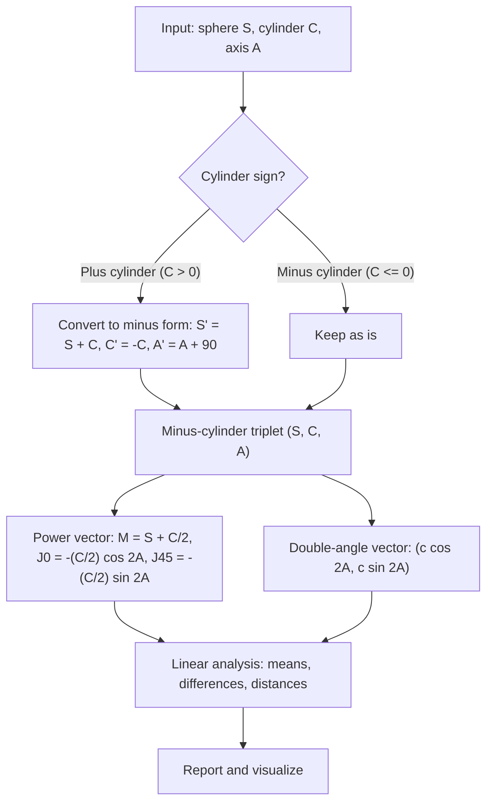
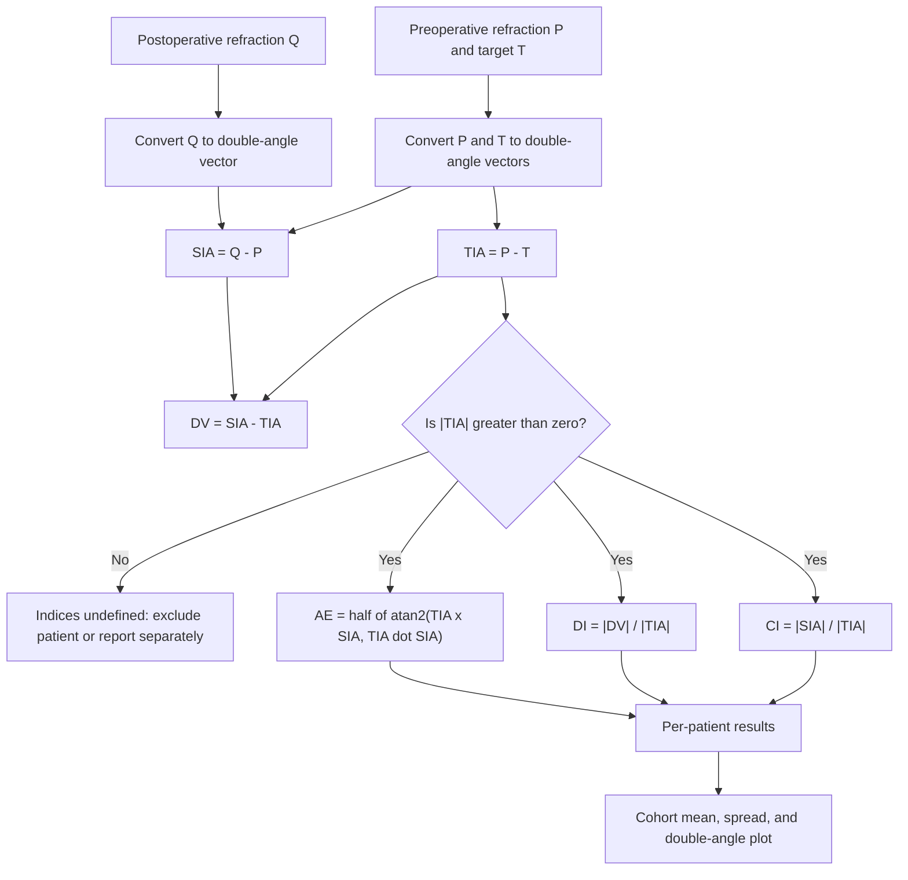
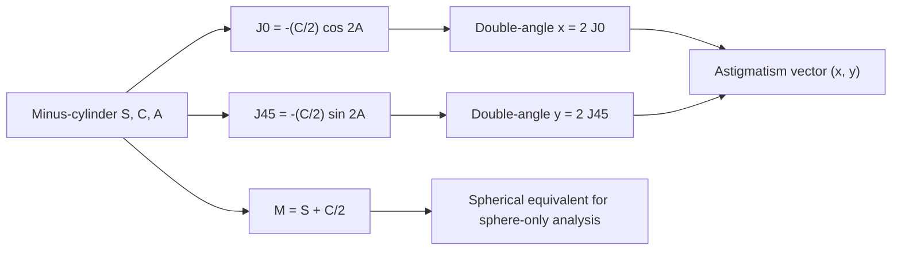

# Vector Analysis of Astigmatism

## Overview

Refractive error is usually written as a sphere-cylinder prescription (S, C, A). Sphere, cylinder, and axis are awkward to average, subtract, or compare. Two standard reformulations solve this:

- **Power vectors** (Thibos, Wheeler & Horner, 1997) rewrite the sphere-cylinder triplet as three numbers (M, J0, J45) that combine linearly. Averages, differences, and distances are then ordinary vector operations.
- **Double-angle vectors** (used in surgical outcome analysis, as in Alpins' method, 1993) represent the cylinder as a 2D vector whose angle is twice the axis. This removes the 180° wrap-around of the axis, so vectors can be subtracted meaningfully.

This project covers both representations, explains how they relate, and implements the indices used to assess astigmatic surgery outcomes: Target-Induced Astigmatism (TIA), Surgically-Induced Astigmatism (SIA), the Difference Vector (DV), the Correction Index (CI), the Discrepancy Index (DI), and the angle of error.

In this project we will:

- Convert between sphere-cylinder and power vector forms.
- Verify that the power vector reproduces the refractive power in every meridian.
- Implement the double-angle representation and its inverse.
- Compute surgical vector indices for a set of patients.
- Compute group means and power-vector distances.
- Visualize the results on a double-angle plot.

A note on naming: the Thibos power vector and the double-angle surgical vectors are well established. The name "Lancaster-Regan method" was not one I could confirm from memory, so this document presents the Thibos power vector and the Alpins-style double-angle analysis, which are the methods Lancaster-style vector notation feeds into. If your source defines the Lancaster-Regan variant differently, send it and the notation can be aligned to it.

---

## 1. Theory

### 1.1 Sphere-cylinder and meridional power

A sphere-cylinder prescription with sphere $S$, cylinder $C$, and axis $A$ (in degrees, $0 \le A < 180$) gives the power in a meridian at angle $\theta$ as

$$
P(\theta) = S + C\,\sin^2(\theta - A)
$$

This convention uses **minus cylinder**, where $C \le 0$ and the axis $A$ is the meridian with power $S$. A plus-cylinder prescription is converted to minus form before any analysis:

$$
S' = S + C, \qquad C' = -C, \qquad A' = (A + 90) \bmod 180
$$

After conversion, let $c = -C \ge 0$ denote the cylinder magnitude.

### 1.2 Thibos power vector

The power vector is

$$
M = S + \frac{C}{2}, \qquad
J_0 = -\frac{C}{2}\cos 2A, \qquad
J_{45} = -\frac{C}{2}\sin 2A
$$

- $M$ is the **spherical equivalent**.
- $J_0$ and $J_{45}$ are the **Fourier components** of the cylinder at $0°$ and $45°$.

The meridional power is recovered exactly as

$$
P(\theta) = M + J_0 \cos 2\theta + J_{45} \sin 2\theta
$$

Proof sketch: expand $S + C\sin^2(\theta - A) = S + \tfrac{C}{2} - \tfrac{C}{2}\cos(2\theta - 2A)$ and apply the angle-difference identity.

Inverse (minus-cylinder form):

$$
c = 2\sqrt{J_0^2 + J_{45}^2}, \qquad
A = \tfrac{1}{2}\operatorname{atan2}(J_{45}, J_0) \pmod{180°}, \qquad
S = M + \frac{c}{2}, \qquad C = -c
$$

When $c = 0$ the axis is undefined, and $A$ is arbitrary. The power vector is still well defined.

### 1.3 Power-vector distance

Because the power vector is linear in $(S, C, A)$, the Euclidean distance between two power vectors

$$
d = \sqrt{(M_1 - M_2)^2 + (J_{0,1} - J_{0,2})^2 + (J_{45,1} - J_{45,2})^2}
$$

is a meaningful dissimilarity between two refractions. It is measured in dioptres.

### 1.4 Double-angle representation

For a cylinder $c$ at axis $A$, the double-angle vector is

$$
\mathbf{v} = \big(c\cos 2A,\; c\sin 2A\big) = 2\,(J_0,\; J_{45})
$$

Doubling the axis removes the 180° periodicity, so an axis of 1° and an axis of 179° are close together on the double-angle circle, as they should be. Vector subtraction then has a physical meaning.

### 1.5 Alpins vector indices for surgery

Let $\mathbf{P}$ be the preoperative astigmatism vector, $\mathbf{Q}$ the postoperative astigmatism vector, and $\mathbf{T}$ the target astigmatism (zero for an emmetropic target). Then:

| Quantity | Definition | Meaning |
|---|---|---|
| Target-Induced Astigmatism (TIA) | $\mathbf{TIA} = \mathbf{P} - \mathbf{T}$ | the astigmatism the procedure was intended to correct |
| Surgically-Induced Astigmatism (SIA) | $\mathbf{SIA} = \mathbf{Q} - \mathbf{P}$ | the astigmatism the procedure actually produced |
| Difference Vector (DV) | $\mathbf{DV} = \mathbf{SIA} - \mathbf{TIA}$ | the residual error relative to the intended correction |
| Correction Index (CI) | $CI = \lvert\mathbf{SIA}\rvert / \lvert\mathbf{TIA}\rvert$ | ratio of achieved to intended correction; 1 is ideal |
| Discrepancy Index (DI) | $DI = \lvert\mathbf{DV}\rvert / \lvert\mathbf{TIA}\rvert$ | size of the residual error relative to the intended correction; 0 is ideal |
| Angle of Error (AE) | $AE = \tfrac{1}{2}\operatorname{atan2}(\mathbf{TIA}\times\mathbf{SIA},\; \mathbf{TIA}\cdot\mathbf{SIA})$ | rotational error in axis, in degrees on the eye; 0 is ideal |

Definitions of composite success indices vary between publications. The table above uses the standard CI, DI, and AE. If your study uses a different success index, define it explicitly in your report.

### 1.6 Group statistics

Power vectors and double-angle vectors can be averaged across patients:

$$
\bar{\mathbf{v}} = \frac{1}{N}\sum_{i=1}^{N} \mathbf{v}_i, \qquad
\bar{M} = \frac{1}{N}\sum_{i=1}^{N} M_i
$$

The length of the mean vector, $|\bar{\mathbf{v}}|$, is the mean astigmatic effect. Its angle, halved, is the mean axis. A mean vector close to zero indicates that errors cancel across patients, which can hide individual variability. Always report the spread alongside the mean.

---

## 2. Algorithm Overview

The complete workflow for a single eye:

1. Normalize each sphere-cylinder prescription to minus-cylinder form.
2. Compute the power vector $(M, J_0, J_{45})$ and, separately, the double-angle astigmatism vector.
3. For surgical outcomes, compute TIA, SIA, DV, CI, DI, and AE.
4. For cohorts, compute means, spreads, and the power-vector distances between conditions.
5. Visualize and report.

The flowcharts below show the same steps in more detail.



---

## 3. Surgical vector workflow

For astigmatic surgery, each patient contributes three refractions: preoperative, postoperative, and the target. The workflow below computes the Alpins indices.



---

## 4. Relationship between the two representations

The power vector and the double-angle vector carry the same astigmatic information. The double-angle vector is simply the power vector's $J$ components scaled by two.



---

## 5. Setup

```python
import numpy as np
import matplotlib.pyplot as plt

plt.rcParams["figure.figsize"] = (7, 6)
plt.rcParams["figure.dpi"] = 120

RANDOM_SEED = 42
rng = np.random.default_rng(RANDOM_SEED)
```

---

## 6. Conversion to minus-cylinder form

```python
def to_minus_cyl(S, C, A):
    """Convert sphere-cylinder prescriptions to minus-cylinder form (C <= 0, 0 <= A < 180)."""
    S = np.asarray(S, dtype=float)
    C = np.asarray(C, dtype=float)
    A = np.asarray(A, dtype=float)
    plus = C > 0
    S_out = np.where(plus, S + C, S)
    C_out = np.where(plus, -C, C)
    A_out = np.where(plus, (A + 90.0) % 180.0, A % 180.0)
    return S_out, C_out, A_out
```

---

## 7. Power vector and its inverse

```python
def power_vector(S, C, A):
    """Thibos power vector (M, J0, J45). Returns an array with last axis of length 3."""
    S, C, A = to_minus_cyl(S, C, A)
    M = S + C / 2.0
    two_A = np.deg2rad(2.0 * A)
    J0 = -(C / 2.0) * np.cos(two_A)
    J45 = -(C / 2.0) * np.sin(two_A)
    return np.stack([M, J0, J45], axis=-1)


def from_power_vector(pv):
    """Inverse: power vector to minus-cylinder (S, C, A)."""
    pv = np.asarray(pv, dtype=float)
    M, J0, J45 = pv[..., 0], pv[..., 1], pv[..., 2]
    c = 2.0 * np.sqrt(J0**2 + J45**2)
    C = -c
    S = M - C / 2.0
    A = (0.5 * np.degrees(np.arctan2(J45, J0))) % 180.0
    return S, C, A
```

### 7.1 Round-trip and meridional-power checks

```python
def meridional_power(S, C, A, theta_deg):
    """Direct formula P(theta) = S + C sin^2(theta - A) for minus-cylinder input."""
    S, C, A = to_minus_cyl(S, C, A)
    return S + C * np.sin(np.deg2rad(theta_deg - A)) ** 2

def meridional_power_from_vector(pv, theta_deg):
    """Power from the vector form P(theta) = M + J0 cos 2theta + J45 sin 2theta."""
    M, J0, J45 = pv[..., 0], pv[..., 1], pv[..., 2]
    t = np.deg2rad(2.0 * theta_deg)
    return M + J0 * np.cos(t) + J45 * np.sin(t)

# Test case: -1.50 DS / -2.00 DC x 30 (minus form)
S0, C0, A0 = -1.50, -2.00, 30.0
pv0 = power_vector(S0, C0, A0)
S1, C1, A1 = from_power_vector(pv0)
print("Power vector (M, J0, J45):", np.round(pv0, 4))
print(f"Round trip: S={S1:.3f}, C={C1:.3f}, A={A1:.2f}")

thetas = np.linspace(0, 180, 7)
direct = meridional_power(S0, C0, A0, thetas)
vector = meridional_power_from_vector(pv0, thetas)
print("Max |direct - vector| across meridians:", np.max(np.abs(direct - vector)))

# Plus-cylinder input should give the same vector as its minus-cylinder equivalent
pv_plus = power_vector(-1.50 + (-2.00), 2.00, 120.0)  # equivalent to -1.50 / -2.00 x 30
print("Plus vs minus form match:", np.allclose(pv_plus, pv0))
```

Expected results: the round trip returns the original triplet, the direct and vector meridional powers agree to floating-point precision, and the plus-cylinder input matches its minus-cylinder equivalent.

---

## 8. Double-angle representation

```python
def double_angle(S, C, A):
    """Astigmatism vector (x, y) = (c cos 2A, c sin 2A), with c = |C| in minus form."""
    _, C_m, A_m = to_minus_cyl(S, C, A)
    c = -C_m
    two_A = np.deg2rad(2.0 * A_m)
    return np.stack([c * np.cos(two_A), c * np.sin(two_A)], axis=-1)

# Check the relation to the power vector: double-angle = 2 * (J0, J45)
pv_check = power_vector(S0, C0, A0)
da_check = double_angle(S0, C0, A0)
print("Double-angle equals 2*(J0, J45):", np.allclose(da_check, 2 * pv_check[..., 1:]))
```

Why this matters: the axes 1° and 179° give double-angle vectors that are almost equal, which matches their clinical meaning. Subtracting axes directly would wrongly treat them as far apart.

---

## 9. Alpins vector indices for surgery

We simulate a cohort of 60 patients with preoperative astigmatism, a target of emmetropia, and a surgically induced astigmatism that has some scatter around a small target-directed effect.

```python
def alpins_indices(pre, post, target=None):
    """
    pre, post, target: arrays of shape (N, 2) of double-angle vectors.
    Returns a dict of per-patient arrays: TIA, SIA, DV, CI, DI, AE_deg.
    """
    pre = np.asarray(pre, float)
    post = np.asarray(post, float)
    target = np.zeros_like(pre) if target is None else np.asarray(target, float)

    TIA = pre - target
    SIA = post - pre
    DV = SIA - TIA

    mag_TIA = np.linalg.norm(TIA, axis=1)
    mag_SIA = np.linalg.norm(SIA, axis=1)
    mag_DV = np.linalg.norm(DV, axis=1)

    valid = mag_TIA > 1e-9
    CI = np.full(len(pre), np.nan)
    DI = np.full(len(pre), np.nan)
    AE = np.full(len(pre), np.nan)
    CI[valid] = mag_SIA[valid] / mag_TIA[valid]
    DI[valid] = mag_DV[valid] / mag_TIA[valid]

    cross_z = TIA[:, 0] * SIA[:, 1] - TIA[:, 1] * SIA[:, 0]
    dot = np.einsum("ij,ij->i", TIA, SIA)
    AE[valid] = 0.5 * np.degrees(np.arctan2(cross_z[valid], dot[valid]))

    return {"TIA": TIA, "SIA": SIA, "DV": DV, "CI": CI, "DI": DI, "AE_deg": AE}


def simulate_cohort(n=60, rng=rng):
    """Preop astigmatism, emmetropic target, and surgery with a noisy target-directed effect."""
    pre_c = rng.uniform(0.75, 2.5, size=n)                  # cylinder magnitude (D)
    pre_a = rng.uniform(0, 180, size=n)                     # axis (deg)
    pre = np.stack([pre_c * np.cos(np.deg2rad(2 * pre_a)),
                    pre_c * np.sin(np.deg2rad(2 * pre_a))], axis=1)

    # Intended correction is -pre (flatten the existing astigmatism).
    # Achieved SIA: 90% of target on average, plus scatter in magnitude and axis.
    gain = rng.normal(0.9, 0.1, size=n)
    axis_err = np.deg2rad(rng.normal(0.0, 4.0, size=n))
    target_sia = -pre * gain[:, None]
    rot = np.stack([np.cos(2 * axis_err), -np.sin(2 * axis_err),
                    np.sin(2 * axis_err), np.cos(2 * axis_err)], axis=1).reshape(n, 2, 2)
    sia = np.einsum("nij,nj->ni", rot, target_sia)
    post = pre + sia
    return pre, post

pre, post = simulate_cohort(n=60)
res = alpins_indices(pre, post)

print(f"Patients: {len(pre)}")
print(f"Mean CI:           {np.nanmean(res['CI']):.3f}  (ideal 1.0)")
print(f"Mean DI:           {np.nanmean(res['DI']):.3f}  (ideal 0.0)")
print(f"Mean |AE| (deg):   {np.nanmean(np.abs(res['AE_deg'])):.2f}  (ideal 0.0)")
print(f"SD of DI:          {np.nanstd(res['DI']):.3f}")
```

Note on the simulation: in real studies, these vectors come from measured preoperative, postoperative, and intended-target refractions. The simulation here is only to exercise the code.

---

## 10. Group statistics

```python
def mean_power_vector(S, C, A):
    pv = power_vector(S, C, A)
    return pv.mean(axis=0), pv.std(axis=0, ddof=1)

def mean_double_angle(S, C, A):
    v = double_angle(S, C, A)
    m = v.mean(axis=0)
    mean_cyl = np.linalg.norm(m)
    mean_axis = (0.5 * np.degrees(np.arctan2(m[1], m[0]))) % 180.0
    return m, mean_cyl, mean_axis

# Cohort of preoperative refractions drawn from the same simulation
S_pre = rng.normal(-0.5, 0.75, size=len(pre))
C_pre = -np.linalg.norm(pre, axis=1)                # minus cylinder magnitude
A_pre = (0.5 * np.degrees(np.arctan2(pre[:, 1], pre[:, 0]))) % 180.0

mean_pv, sd_pv = mean_power_vector(S_pre, C_pre, A_pre)
print("Mean power vector (M, J0, J45):", np.round(mean_pv, 3))
print("SD of power vector:            ", np.round(sd_pv, 3))

m_da, mean_cyl, mean_axis = mean_double_angle(S_pre, C_pre, A_pre)
print(f"Mean astigmatism: {mean_cyl:.3f} D at {mean_axis:.1f} deg")

pv_pre = power_vector(S_pre, C_pre, A_pre)
```

The postoperative power vector is computed next by converting the postoperative double-angle vector back into (S, C, A) and then applying the power-vector formula.

```python
def double_angle_to_sca(vec, S):
    """Convert double-angle astigmatism vectors back to minus-cylinder (S, C, A)."""
    c = np.linalg.norm(vec, axis=1)
    A = (0.5 * np.degrees(np.arctan2(vec[:, 1], vec[:, 0]))) % 180.0
    return S, -c, A

post_vec = res["SIA"] + pre  # post-op astigmatism vector (recovered from simulation)
S_post2, C_post2, A_post2 = double_angle_to_sca(post_vec, S_pre + rng.normal(0.0, 0.2, size=len(pre)))
pv_post = power_vector(S_post2, C_post2, A_post2)

dist = np.linalg.norm(pv_post - pv_pre, axis=1)
print(f"Power-vector distance pre vs post: mean {dist.mean():.3f} D, "
      f"SD {dist.std(ddof=1):.3f} D")
```

Here `post_vec` is the postoperative astigmatism vector obtained from the simulation, and `double_angle_to_sca` converts it back to the (S, C, A) form before computing the power vector. The sphere on the post side is an illustrative drift, not a measured value.

---

## 11. Visualization: double-angle plot

The double-angle plane is the natural place to see surgical outcomes. Each patient's TIA and SIA are plotted as arrows; DV connects the tip of TIA to the tip of SIA.

```python
def plot_double_angle(res, n_show=25):
    fig, ax = plt.subplots(figsize=(6.5, 6.5))
    idx = np.arange(min(n_show, len(res["TIA"])))
    for i in idx:
        T = res["TIA"][i]
        S_ = res["SIA"][i]
        ax.annotate("", xy=S_, xytext=(0, 0),
                    arrowprops=dict(arrowstyle="->", color="C0", alpha=0.6, lw=1))
        ax.annotate("", xy=T, xytext=(0, 0),
                    arrowprops=dict(arrowstyle="->", color="C3", alpha=0.6, lw=1))
    ax.scatter(res["SIA"][idx, 0], res["SIA"][idx, 1], s=12, color="C0", label="SIA")
    ax.scatter(res["TIA"][idx, 0], res["TIA"][idx, 1], s=12, color="C3", label="TIA")
    lim = np.max(np.abs(np.vstack([res["SIA"], res["TIA"]]))) * 1.15
    ax.set_xlim(-lim, lim)
    ax.set_ylim(-lim, lim)
    ax.axhline(0, color="gray", lw=0.6)
    ax.axvline(0, color="gray", lw=0.6)
    ax.set_aspect("equal")
    ax.set_xlabel("Double-angle x (D)")
    ax.set_ylabel("Double-angle y (D)")
    ax.set_title("Surgical Astigmatism: TIA (red) and SIA (blue)")
    ax.legend(loc="upper right")
    plt.show()

plot_double_angle(res)

plt.figure()
plt.hist(res["DI"][~np.isnan(res["DI"])], bins=15, color="C2", edgecolor="k")
plt.xlabel("Discrepancy index (DI)")
plt.ylabel("Number of patients")
plt.title("Distribution of Discrepancy Index")
plt.show()
```

---

## 12. Analytics summary

```python
print("Per-patient indices (first 5):")
print(f"{'i':>3} {'CI':>7} {'DI':>7} {'AE (deg)':>10}")
for i in range(5):
    print(f"{i:>3} {res['CI'][i]:>7.3f} {res['DI'][i]:>7.3f} {res['AE_deg'][i]:>10.2f}")

print("\nCohort summary:")
print(f"  CI  mean {np.nanmean(res['CI']):.3f}, SD {np.nanstd(res['CI']):.3f}")
print(f"  DI  mean {np.nanmean(res['DI']):.3f}, SD {np.nanstd(res['DI']):.3f}")
print(f"  AE  mean {np.nanmean(res['AE_deg']):+.2f}, SD {np.nanstd(res['AE_deg']):.2f} deg")
```

Interpretation: a CI near 1 and a DI near 0 indicate that the procedure delivered the intended correction. A large spread in AE indicates axis instability, which is often more clinically important than a small magnitude error.

---

## 13. Optional extensions

### 13.1 Mean vector versus individual error

The mean vector can look good while individuals vary widely. Always report spread and, where possible, the fraction of patients inside a clinically defined tolerance band in both magnitude and axis.

### 13.2 Confidence regions

For a cohort of double-angle vectors, a confidence region for the mean can be drawn as an ellipse from the covariance of the vectors, using the Hotelling or bootstrap approach. This is a natural next step once the basic indices are in place.

### 13.3 Non-minus form and plus cylinders

Always convert to minus form before computing the power vector. Mixing plus and minus cylinders in the same cohort without conversion produces wrong averages.

### 13.4 Connection to other vector methods

Thibos power vectors also support Fourier-based analysis of wavefront or corneal data across many meridians, not just the three-component summary. For higher-order wavefront analysis, see the Zernike project in this collection.

---

## 14. Summary

In this project we:

- Defined the sphere-cylinder model and the minus-cylinder convention.
- Derived the Thibos power vector (M, J0, J45) and its inverse, and verified the meridional power identity numerically.
- Introduced the double-angle representation and its relation to the power vector.
- Implemented Alpins-style surgical vector indices (TIA, SIA, DV, CI, DI, AE).
- Computed cohort means, spreads, and power-vector distances.
- Visualized surgical outcomes on the double-angle plane.

## References

- Thibos, L. N., Wheeler, W., & Horner, D. (1997). Power vectors: An application of Fourier analysis to the description and statistical analysis of refractive error. *Optometry and Vision Science*, 74(6), 367–375.
- Alpins, N. A. (1993). A new method of analyzing vectors for changes in astigmatism. *Journal of Cataract and Refractive Surgery*, 19(5), 524–533.

These references were written from memory. Please verify volume, page numbers, and the definitions of CI, DI, and AE against the originals before publishing.
