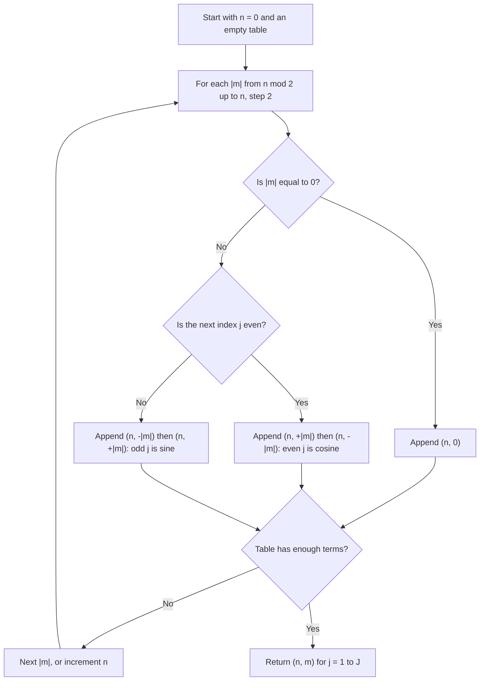
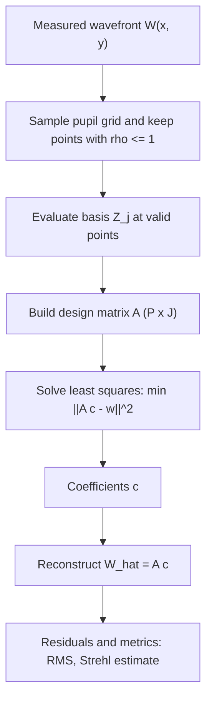

# Zernike Polynomials

## Overview

Zernike polynomials are a complete, orthogonal set of functions defined on the unit disk. Because they are orthogonal over a circular aperture and map cleanly onto familiar optical aberrations, they are the standard basis for describing wavefront error in optics, adaptive optics, ophthalmic aberrometry, and corneal topography.

In this project we will:

- Define the radial and azimuthal components of Zernike polynomials.
- Apply the normalization convention and Noll indexing used in optics.
- Visualize the first terms of the basis and relate them to classical aberrations.
- Verify numerically that the basis is orthonormal over the unit disk.
- Decompose a synthetic wavefront into Zernike coefficients by least squares.
- Compute fitting metrics (RMS wavefront error, residuals, Strehl ratio estimate).
- Study how measurement noise affects coefficient recovery.
- Discuss extensions: non-circular pupils, slope-based sensing, and alternative indexing schemes.

---

## 1. Theory

### 1.1 The unit disk

Zernike polynomials are expressed in polar coordinates $(\rho, \theta)$ over the unit disk:

$$
0 \le \rho \le 1, \qquad 0 \le \theta < 2\pi
$$

A Cartesian point $(x, y)$ maps to polar coordinates via $\rho = \sqrt{x^2 + y^2}$ and $\theta = \operatorname{atan2}(y, x)$. In practice, a pupil of radius $a$ is normalized so that $\rho = r / a$.

### 1.2 Radial polynomials

For integers $n \ge 0$ and $m$ with $|m| \le n$ and $n - |m|$ even, the radial polynomial is

$$
R_n^{|m|}(\rho) = \sum_{k=0}^{(n-|m|)/2} \frac{(-1)^k \, (n-k)!}{k! \, \left(\frac{n+|m|}{2} - k\right)! \, \left(\frac{n-|m|}{2} - k\right)!} \, \rho^{\,n-2k}
$$

Key properties:

- $R_n^{|m|}(1) = 1$ for all valid $(n, m)$.
- $R_n^{|m|}$ is a polynomial in $\rho$ of degree $n$ with only powers $\rho^{n}, \rho^{n-2}, \dots$.
- $R_n^{|m|}(\rho) = \rho^{|m|} P(\rho^2)$, so it is regular at the origin.

### 1.3 Azimuthal part and full definition

The (unnormalized) Zernike polynomial is

$$
Z_n^m(\rho, \theta) = R_n^{|m|}(\rho) \times
\begin{cases}
\cos(m\theta) & m \ge 0 \\
\sin(|m|\theta) & m < 0
\end{cases}
$$

The index $m$ carries the sign that distinguishes the cosine ("even") and sine ("odd") forms. Two conventions that appear in the literature are:

- **Unnormalized** (as above), where $\int Z^2 \, dA$ is not constant across terms.
- **Normalized** (used throughout this project), where each term has unit variance over the disk.

### 1.4 Normalization

The normalized Zernike polynomials multiply the unnormalized form by a factor $N_n^m$:

$$
N_n^m = \begin{cases}
\sqrt{2(n+1)} & m \neq 0 \\
\sqrt{n+1} & m = 0
\end{cases}
$$

With this choice, the basis satisfies

$$
\frac{1}{\pi} \int_0^{2\pi} \int_0^1 Z_n^m(\rho,\theta) \, Z_{n'}^{m'}(\rho,\theta) \, \rho \, d\rho \, d\theta = \delta_{nn'} \, \delta_{mm'}
$$

The $m = 0$ case is special: $\cos(0) = 1$, so there is no averaging over $\theta$, and the normalization factor is therefore $\sqrt{n+1}$ rather than $\sqrt{2(n+1)}$.

### 1.5 Noll indexing

Each $(n, m)$ pair is assigned a single index $j \ge 1$. The most common scheme in optics is due to Noll (1976). Its rules are:

1. Order terms by increasing radial order $n$.
2. Within a given $n$, order by increasing $|m|$.
3. For $m \neq 0$, the pair of terms with the same $|m|$ occupies two consecutive indices. An even $j$ corresponds to the cosine term ($m > 0$), and an odd $j$ corresponds to the sine term ($m < 0$).

This makes Noll indices independent of the number of terms retained, which is convenient when truncating a fit.



### 1.6 Common terms

The table below lists the first eleven terms in Noll indexing. Names follow common clinical and optical usage; some labels (for example "oblique" versus "vertical" astigmatism) vary between references.

| Noll $j$ | $(n, m)$ | Name | Normalized form |
|---|---|---|---|
| 1 | (0, 0) | Piston | $1$ |
| 2 | (1, +1) | Tilt X | $2\rho\cos\theta$ |
| 3 | (1, −1) | Tilt Y | $2\rho\sin\theta$ |
| 4 | (2, 0) | Defocus | $\sqrt{3}\,(2\rho^2 - 1)$ |
| 5 | (2, −2) | Oblique astigmatism | $\sqrt{6}\,\rho^2\sin 2\theta$ |
| 6 | (2, +2) | Vertical astigmatism | $\sqrt{6}\,\rho^2\cos 2\theta$ |
| 7 | (3, −1) | Vertical coma | $\sqrt{8}\,(3\rho^3 - 2\rho)\sin\theta$ |
| 8 | (3, +1) | Horizontal coma | $\sqrt{8}\,(3\rho^3 - 2\rho)\cos\theta$ |
| 9 | (3, −3) | Oblique trefoil | $\sqrt{8}\,\rho^3\sin 3\theta$ |
| 10 | (3, +3) | Vertical trefoil | $\sqrt{8}\,\rho^3\cos 3\theta$ |
| 11 | (4, 0) | Primary spherical | $\sqrt{5}\,(6\rho^4 - 6\rho^2 + 1)$ |

Piston and tilt do not affect image sharpness, so wavefront quality metrics often exclude $j = 1$ to $3$.

---

## 2. Algorithm Overview

To decompose a measured wavefront $W(x, y)$ over a circular pupil:

1. Sample the pupil on a grid and keep points with $\rho \le 1$.
2. Evaluate each of the $J$ basis functions $Z_j$ at the valid points, forming a design matrix $A \in \mathbb{R}^{P \times J}$, where $P$ is the number of valid points.
3. Solve the least-squares problem $\min_c \|A c - w\|^2$ for coefficients $c$, where $w$ holds the measured wavefront samples.
4. Reconstruct $\hat{W} = A c$, and compute residuals and metrics.

Because the basis is orthonormal over the continuous disk, the least-squares solution approximates the projection of $W$ onto each term. On a discrete grid, orthonormality holds only approximately, so the solver is used rather than a simple dot product.



---

## 3. Setup

```python
import numpy as np
import matplotlib.pyplot as plt
from math import factorial

plt.rcParams["figure.figsize"] = (8, 6)
plt.rcParams["figure.dpi"] = 120

RANDOM_SEED = 42
rng = np.random.default_rng(RANDOM_SEED)
```

---

## 4. Radial polynomials

```python
def radial(n, m, rho):
    """Radial Zernike polynomial R_n^{|m|}(rho)."""
    m = abs(m)
    if (n - m) % 2 != 0 or m > n:
        raise ValueError("Require |m| <= n and n - |m| even.")
    R = np.zeros_like(rho, dtype=float)
    for k in range((n - m) // 2 + 1):
        coeff = ((-1) ** k * factorial(n - k)) / (
            factorial(k)
            * factorial((n + m) // 2 - k)
            * factorial((n - m) // 2 - k)
        )
        R += coeff * rho ** (n - 2 * k)
    return R
```

Sanity check against the closed forms from the table:

```python
rho_test = np.linspace(0, 1, 5)
print("R_2^0 :", np.round(radial(2, 0, rho_test), 4))
print("expect:", np.round(2 * rho_test**2 - 1, 4))
print("R_4^0 :", np.round(radial(4, 0, rho_test), 4))
print("expect:", np.round(6 * rho_test**4 - 6 * rho_test**2 + 1, 4))
```

---

## 5. Full normalized Zernike polynomial

```python
def zernike(n, m, rho, theta):
    """Normalized Zernike polynomial Z_n^m(rho, theta)."""
    norm = np.sqrt(2 * (n + 1)) if m != 0 else np.sqrt(n + 1)
    R = radial(n, m, rho)
    if m == 0:
        return norm * R
    if m > 0:
        return norm * R * np.cos(m * theta)
    return norm * R * np.sin(-m * theta)
```

---

## 6. Noll indexing

```python
def noll_table(num_terms):
    """Return a list of (n, m) pairs for Noll indices j = 1..num_terms."""
    table = []
    n = 0
    while len(table) < num_terms:
        for m_abs in range(n % 2, n + 1, 2):
            if m_abs == 0:
                table.append((n, 0))
            else:
                start = len(table) + 1           # 1-based Noll index of the first term
                if start % 2 == 0:               # even j -> cosine (m > 0)
                    table.append((n, +m_abs))
                    table.append((n, -m_abs))
                else:                            # odd j -> sine (m < 0)
                    table.append((n, -m_abs))
                    table.append((n, +m_abs))
        n += 1
    return table[:num_terms]

NOLL = noll_table(37)
for j, (n, m) in enumerate(NOLL[:11], start=1):
    print(f"j={j:2d}  (n={n}, m={m:+d})")
```

The printed pairs should match the table in Section 1.6.

---

## 7. Evaluating the basis on a grid

```python
def pupil_grid(N=128):
    """Square grid on [-1, 1]^2 with polar coordinates and a unit-disk mask."""
    x = np.linspace(-1.0, 1.0, N)
    X, Y = np.meshgrid(x, x)
    rho = np.hypot(X, Y)
    theta = np.arctan2(Y, X)
    mask = rho <= 1.0
    dA = (x[1] - x[0]) ** 2
    return X, Y, rho, theta, mask, dA


def design_matrix(rho, theta, J):
    """Columns are Z_j evaluated at the given (rho, theta) points, j = 1..J."""
    cols = [zernike(n, m, rho, theta) for (n, m) in NOLL[:J]]
    return np.column_stack(cols)
```

---

## 8. Visualizing the basis

```python
X, Y, rho, theta, mask, dA = pupil_grid(N=256)
J_show = 16
fig, axes = plt.subplots(4, 4, figsize=(9, 9))
for j, ax in enumerate(axes.ravel(), start=1):
    n, m = NOLL[j - 1]
    Z = np.full_like(rho, np.nan)
    Z[mask] = zernike(n, m, rho[mask], theta[mask])
    im = ax.imshow(Z, cmap="RdBu_r", extent=[-1, 1, -1, 1])
    ax.set_title(f"j={j} (n={n}, m={m:+d})", fontsize=9)
    ax.axis("off")
fig.suptitle("Normalized Zernike Basis (Noll j = 1..16)")
plt.tight_layout()
plt.show()
```

Discussion: the rows of the mosaic show increasing radial order. Within a row, terms with the same $n$ differ in angular frequency $|m|$, so the number of azimuthal lobes grows from left to right.

---

## 9. Orthonormality check

The basis is orthonormal over the continuous disk. We check this numerically by approximating the integral on a grid.

```python
def orthonormality_gram(J, N=400):
    X, Y, rho, theta, mask, dA = pupil_grid(N)
    B = design_matrix(rho[mask], theta[mask], J)
    G = (B.T @ B) * dA / np.pi
    return G

G = orthonormality_gram(J=15)
print("Max |G - I| :", np.max(np.abs(G - np.eye(G.shape[0]))))
print("Diagonal    :", np.round(np.diag(G), 3))

plt.figure()
plt.imshow(G, cmap="coolwarm", vmin=-0.05, vmax=1.05)
plt.colorbar(label="Inner product / pi")
plt.title("Gram Matrix of Zernike Basis (should be ~ identity)")
plt.xlabel("j")
plt.ylabel("j")
plt.show()
```

Expected result: the diagonal is close to 1, and off-diagonal entries are close to 0. Small deviations come from grid discretization and shrink as $N$ grows.

---

## 10. Synthetic wavefront

We build a known wavefront from a few aberrations, measured in waves, and add optional noise. This lets us check whether the decomposition recovers the true coefficients.

```python
J_FIT = 15

true_coeffs = np.zeros(J_FIT)
true_coeffs[3] = 0.50    # defocus (j=4)
true_coeffs[4] = 0.20    # oblique astigmatism (j=5)
true_coeffs[5] = -0.30   # vertical astigmatism (j=6)
true_coeffs[6] = 0.15    # vertical coma (j=7)
true_coeffs[7] = 0.10    # horizontal coma (j=8)
true_coeffs[10] = 0.12   # primary spherical (j=11)

X, Y, rho, theta, mask, dA = pupil_grid(N=128)
r_pts = rho[mask]
t_pts = theta[mask]

B = design_matrix(r_pts, t_pts, J_FIT)
W_true = B @ true_coeffs
W_measured = W_true + rng.normal(0.0, 0.01, size=W_true.shape)  # 0.01 waves noise

W_map = np.full_like(rho, np.nan)
W_map[mask] = W_measured
plt.figure()
plt.imshow(W_map, cmap="viridis", extent=[-1, 1, -1, 1])
plt.colorbar(label="Wavefront error (waves)")
plt.title("Synthetic Measured Wavefront")
plt.show()
```

---

## 11. Least-squares decomposition

```python
coeffs_hat, residuals, rank, sv = np.linalg.lstsq(B, W_measured, rcond=None)

print(f"{'j':>3} {'true':>8} {'recovered':>10} {'error':>8}")
for j in range(J_FIT):
    print(f"{j+1:>3} {true_coeffs[j]:>8.3f} {coeffs_hat[j]:>10.3f} "
          f"{coeffs_hat[j] - true_coeffs[j]:>8.3f}")

plt.figure()
idx = np.arange(1, J_FIT + 1)
plt.stem(idx, true_coeffs, linefmt="C0-", markerfmt="C0o", basefmt=" ", label="True")
plt.stem(idx + 0.15, coeffs_hat, linefmt="C3-", markerfmt="C3s", basefmt=" ", label="Recovered")
plt.xlabel("Noll index j")
plt.ylabel("Coefficient (waves)")
plt.title("True vs Recovered Zernike Coefficients")
plt.legend()
plt.show()
```

---

## 12. Reconstruction and metrics

```python
W_hat = B @ coeffs_hat
residual = W_measured - W_hat

def rms(v):
    return np.sqrt(np.mean(v ** 2))

# Piston (j=1) does not affect image quality, so we remove it for the metrics
rms_total = rms(W_measured - np.mean(W_measured))
rms_residual = rms(residual)
rms_fit_error = rms(W_hat - W_true)

print(f"RMS wavefront error (piston removed): {rms_total:.4f} waves")
print(f"RMS fit residual:                     {rms_residual:.4f} waves")
print(f"RMS error vs. noiseless truth:        {rms_fit_error:.4f} waves")

# Reconstructed wavefront map and residual map
fig, axes = plt.subplots(1, 3, figsize=(13, 4))
for ax, data, title in zip(
    axes,
    [W_true, W_hat, residual],
    ["Truth (noiseless)", "Reconstruction", "Residual"],
):
    M = np.full_like(rho, np.nan)
    M[mask] = data
    im = ax.imshow(M, cmap="viridis" if title != "Residual" else "RdBu_r",
                   extent=[-1, 1, -1, 1])
    ax.set_title(title)
    ax.axis("off")
    fig.colorbar(im, ax=ax, fraction=0.046)
plt.tight_layout()
plt.show()
```

### Strehl ratio estimate

The Maréchal approximation relates the RMS wavefront error $\sigma$ (in waves) to the Strehl ratio, which is the peak intensity relative to a perfect system:

$$
S \approx \exp\left[-(2\pi\sigma)^2\right]
$$

This approximation is reliable for small aberrations, roughly $\sigma < 0.1$ waves.

```python
def strehl_marechal(sigma_waves):
    return np.exp(-(2 * np.pi * sigma_waves) ** 2)

print(f"Strehl (from fitted RMS): {strehl_marechal(rms_total):.3f}")
```

---

## 13. Noise sensitivity

We repeat the fit for several noise levels to see how coefficient error scales.

```python
noise_levels = np.logspace(-3, -1, 12)   # 0.001 to 0.1 waves
coeff_errors = []
for sigma_n in noise_levels:
    errs = []
    for _ in range(20):                  # average over random noise draws
        w = W_true + rng.normal(0.0, sigma_n, size=W_true.shape)
        c_hat, *_ = np.linalg.lstsq(B, w, rcond=None)
        errs.append(np.sqrt(np.mean((c_hat - true_coeffs) ** 2)))
    coeff_errors.append(np.mean(errs))

plt.figure()
plt.loglog(noise_levels, coeff_errors, "o-")
plt.loglog(noise_levels, noise_levels, "--", label="y = x (reference)")
plt.xlabel("Measurement noise, RMS (waves)")
plt.ylabel("Coefficient error, RMS (waves)")
plt.title("Coefficient Recovery vs. Noise")
plt.legend()
plt.show()
```

Expected behavior: on a well-sampled circular pupil, coefficient error scales roughly linearly with noise, since the basis is orthonormal and the noise is spread across terms.

---

## 14. Analytics summary

```python
energy = coeffs_hat[1:] ** 2
total_energy = np.sum(energy)
print("Share of fitted wavefront energy (excluding piston):")
for j in range(1, J_FIT):
    share = energy[j - 1] / total_energy
    if share > 0.01:
        n, m = NOLL[j]
        print(f"  j={j+1:2d} (n={n}, m={m:+d}): {share:6.1%}")

plt.figure()
plt.bar(np.arange(2, J_FIT + 1), coeffs_hat[1:] ** 2)
plt.xlabel("Noll index j")
plt.ylabel("Coefficient squared (waves²)")
plt.title("Modal Power Spectrum of the Fitted Wavefront")
plt.show()
```

The modal power spectrum shows which aberrations dominate, which is the usual first step in clinical or design interpretation.

---

## 15. Optional extensions

### 15.1 Non-circular or annular pupils

Zernike polynomials are orthogonal only on the full unit disk. For annular pupils (a central obstruction, common in telescopes), the standard approach is to apply Gram–Schmidt orthogonalization over the actual pupil mask. For arbitrary shapes, a least-squares fit without an orthogonality assumption is also valid.

```python
def gram_schmidt_basis(B, weights=None):
    """Orthonormalize the columns of B with respect to a discrete inner product."""
    Q = np.zeros_like(B)
    for k in range(B.shape[1]):
        v = B[:, k].copy()
        for i in range(k):
            v -= np.dot(Q[:, i], v) * Q[:, i]
        Q[:, k] = v / np.linalg.norm(v)
    return Q
```

### 15.2 Slope-based sensing

Shack–Hartmann sensors measure wavefront slopes, not height. Zernike fits can be performed on slopes by differentiating the basis analytically or numerically, then solving the slope equations $\nabla W \approx \nabla(Ac)$. This is the standard approach in adaptive optics reconstruction.

### 15.3 Alternative indexing

Other common schemes include the OSA/ANSI standard index (which numbers terms by $j = (n(n+2)+m)/2$) and the Fringe (University of Arizona) index. The same polynomials are used, but the ordering and sign conventions differ, so always confirm which convention a dataset or instrument uses before comparing coefficients.

### 15.4 Real-data workflow

Recommended steps for measured data:

1. Mask out invalid pixels (noise, shadows, or obstructions).
2. Remove piston and tilt if the analysis concerns image quality rather than pointing.
3. Fit with a chosen order $J$, and check the fit residual against the noise floor.
4. Compare the coefficient set against expected physical sources before interpreting results.

---

## 16. Summary

In this project we:

- Defined radial and azimuthal Zernike components and their normalization.
- Implemented Noll indexing and the full normalized basis.
- Visualized the first sixteen terms and related them to classical aberrations.
- Verified orthonormality numerically with a Gram matrix.
- Decomposed a synthetic wavefront by least squares and recovered known coefficients.
- Computed RMS error, residuals, and a Maréchal-based Strehl estimate.
- Studied coefficient error as a function of measurement noise.
- Outlined extensions for non-circular pupils, slope sensing, and alternative indexing.

## References

- Noll, R. J. (1976). Zernike polynomials and atmospheric turbulence. *Journal of the Optical Society of America*, 66(3), 207–211.
- Born, M., & Wolf, E. *Principles of Optics*. Cambridge University Press. (Chapter on diffraction theory and the circle polynomials.)
- Thibos, L. N., Applegate, R. A., Schwiegerling, J. T., & Webb, R. (2002). Standards for reporting the optical aberrations of eyes. *Journal of Refractive Surgery*, 18(5), S652–S660.
